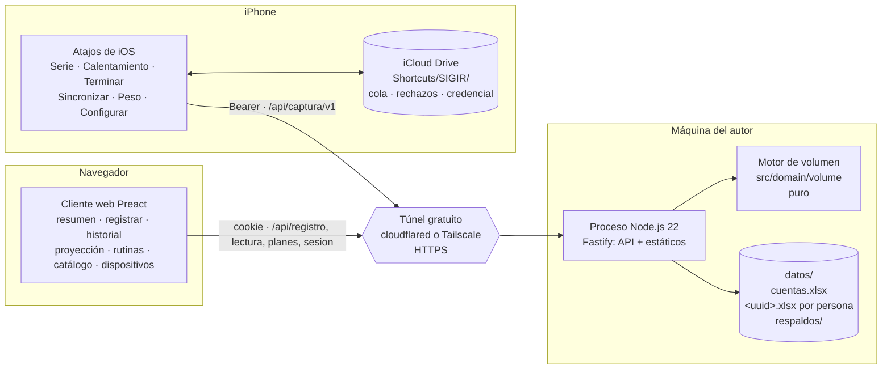
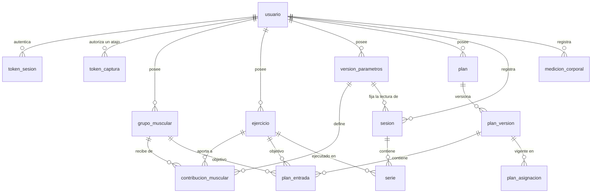

# Plan — SIGIR Fitness

> Documento maestro del proyecto: qué problema resuelve, qué se quería
> construir, cómo se construyó, con qué tecnologías, qué se hizo, qué cambió por
> el camino, qué falta y qué convendría mejorar. Está escrito para que alguien
> que no ha visto el repositorio pueda entenderlo entero y, sobre todo, para que
> pueda **arrancar un proyecto de este estilo** sin repetir los errores que aquí
> ya se cometieron y se corrigieron.
>
> Fecha de redacción: **26 de septiembre de 2026**. Rama: `fase-1`. Las cifras
> de pruebas, archivos y dependencias se comprobaron ejecutando el repositorio
> ese día, no copiándolas de otros documentos.

---

## Índice

0. [Cómo leer este documento](#0-cómo-leer-este-documento)
1. [Resumen en una página](#1-resumen-en-una-página)
2. [El problema](#2-el-problema)
3. [El objetivo y sus límites](#3-el-objetivo-y-sus-límites)
4. [Cómo se desarrolló: método y cronología](#4-cómo-se-desarrolló-método-y-cronología)
5. [Arquitectura actual](#5-arquitectura-actual)
6. [Tecnologías](#6-tecnologías)
7. [Modelo de datos](#7-modelo-de-datos)
8. [El motor de volumen](#8-el-motor-de-volumen)
9. [Contratos HTTP](#9-contratos-http)
10. [Seguridad y privacidad](#10-seguridad-y-privacidad)
11. [Los dos clientes: web y atajos de iOS](#11-los-dos-clientes-web-y-atajos-de-ios)
12. [Catálogo base](#12-catálogo-base)
13. [Lenguaje visual](#13-lenguaje-visual)
14. [Calidad y verificación](#14-calidad-y-verificación)
15. [Operación: ponerlo en marcha y mantenerlo](#15-operación-ponerlo-en-marcha-y-mantenerlo)
16. [Estado actual](#16-estado-actual)
17. [Lo que se planeaba y falta](#17-lo-que-se-planeaba-y-falta)
18. [Riesgos](#18-riesgos)
19. [Mejoras a considerar](#19-mejoras-a-considerar)
20. [Guía para arrancar un proyecto de este estilo](#20-guía-para-arrancar-un-proyecto-de-este-estilo)
21. [Mapa de documentos](#21-mapa-de-documentos)
22. [Glosario](#22-glosario)

---

## 0. Cómo leer este documento

Este archivo **resume y conecta**; no sustituye a los documentos de detalle. Cada
sección dice de dónde sale y dónde está el detalle completo. Si algo de aquí
contradice a un ADR aceptado de `docs/01-decisiones.md`, manda el ADR, y este
documento tiene un error que hay que corregir.

Según lo que busques:

| Si quieres…                                        | Lee                                          |
| -------------------------------------------------- | -------------------------------------------- |
| Entender el proyecto en diez minutos               | §1, §2 y §3                                  |
| Ponerlo en marcha en tu máquina                    | §15                                          |
| Saber qué está hecho y qué falta                   | §16 y §17                                    |
| Tocar el código sin romper nada                    | §5, §7, §8 y `CLAUDE.md`                     |
| Arrancar un proyecto parecido desde cero           | §4 y §20                                     |
| Proponer una mejora                                | §19 y, antes, §4.2 (cómo se decide aquí)     |

Convención de todo el repositorio: el código, los comentarios y la documentación
están en **español**, y los identificadores también (`agrega`, `fechaLogica`,
`conAlmacenDeUsuario`). No es un capricho: el dominio se piensa en español y
traducir los nombres del dominio a medias es la forma más rápida de que dos
personas llamen distinto a la misma cosa.

---

## 1. Resumen en una página

**SIGIR Fitness** es una aplicación personal de seguimiento de entrenamiento de
fuerza. Cuenta cuántas **series efectivas** recibe cada **grupo muscular** por
semana, y compara lo **planeado** con lo **ejecutado**.

- **Usuarios**: dos personas —el autor y un amigo—. El modelo es multiusuario
  desde el día uno; el producto no tiene registro público.
- **Coste**: cero, como requisito explícito. No hay hosting, ni base de datos
  gestionada, ni dominio.
- **Dónde corre**: en la máquina del autor, como un único proceso de Node.js
  que sirve la API y el cliente web, publicado con un **túnel gratuito**
  (Cloudflare Tunnel o Tailscale).
- **Dónde viven los datos**: en **libros de Excel** (`.xlsx`), uno por persona,
  más un `cuentas.xlsx`. Se pueden abrir y editar a mano en Excel, LibreOffice o
  Google Sheets, y el servidor valida todo al cargar.
- **Cómo se captura**: dos vías que llaman al **mismo servicio**:
  - **Atajos de iOS** (seis atajos) contra `/api/captura/v1`, con credencial de
    portador y cola local en iCloud Drive, para registrar una serie desde la
    pantalla bloqueada entre series.
  - **La pantalla «Registrar»** del cliente web, contra `/api/registro/v1`, para
    quien no tenga iPhone o cuando el servidor estuvo apagado.
- **Cómo se lee**: un cliente web en Preact con resumen semanal, historial,
  proyección de un plan, constructor de rutinas, catálogo y dispositivos.
- **El corazón**: un **motor de volumen puro** en `src/domain/volume/`, sin
  dependencias, sin reloj y sin coma flotante, que es el único sitio del sistema
  donde se calcula volumen. El plan y lo ejecutado pasan por la misma función.
- **Estado (09/10/2026)**: fases 0, 1, 2 y **3** en código —la comparativa
  plan-contra-real, que da nombre al proyecto, con su vigilancia del umbral, la
  simulación, la línea semanal del atajo y el mapa «Comparado con el plan»
  (ADR-019)—, más la fase de producto (catálogo base de 182 ejercicios, rangos de
  referencia, constructor de rutinas y rediseño visual), la baja de cuenta, el
  alta pública con tope (ADR-020), «Ver ejemplo»: una figura animada propia
  para cada ejercicio del catálogo base, donde se elija un ejercicio (ADR-021),
  «Registrar» que empieza por la rutina del día, con lo que va hecho, y registra
  un día elegido en su fecha (ADR-022 y 026),
  las cargas en libras con el peso corporal en kilos (ADR-023) y el historial en
  tabla con área, carga media y progreso (ADR-024), con sus gráficas de las
  últimas ocho semanas: músculos trabajados y fuerza estimada por tren (ADR-025).
  **422 pruebas en verde**, lint limpio, ensayo de 22 afirmaciones. Falta
  **probar los atajos en un iPhone real**.

---

## 2. El problema

Fuente: `docs/00-spec.md` (la especificación original, escrita como encargo a un
ingeniero senior) y los ADR que la responden.

### 2.1 Qué se quiere saber

Quien entrena fuerza con un objetivo de hipertrofia necesita contestar una
pregunta que ninguna libreta contesta bien: **¿cuánto estímulo real recibió cada
músculo esta semana, y es lo que yo planeaba?** Un press de banca entrena el
pectoral, pero también el tríceps y el deltoides anterior; una sentadilla entrena
el cuádriceps y el glúteo, pero no los isquiosurales. Sumar «ejercicios» o
«series» a secas no dice nada útil por músculo.

### 2.2 Por qué es más difícil de lo que parece

El proyecto se tomó en serio estas ocho trampas. Cada una, si se ignora, produce
un número **equivocado pero plausible**, que es el peor tipo de error: nadie lo
detecta y el usuario entrena peor durante meses creyendo que entrena mejor.

| # | Trampa                                   | Qué sale mal si se ignora                                                                    | Cómo se resolvió                                                                 |
| - | ---------------------------------------- | --------------------------------------------------------------------------------------------- | -------------------------------------------------------------------------------- |
| 1 | **Series de calentamiento**              | El volumen sale inflado de forma sistemática.                                                 | Bandera obligatoria; el motor las descarta él mismo. En la captura, la bandera **es el atajo o el botón**. |
| 2 | **Sesión que cruza la medianoche**       | Un entrenamiento de 23:50 a 00:15 aparece como dos sesiones cortas en dos días.               | **Fecha lógica** de la sesión, distinta del instante de cada serie. El motor no ve la hora. |
| 3 | **Doble conteo de intensidad**           | Multiplicar series × carga × repeticiones × RIR cuenta la intensidad dos veces.               | La métrica es **conteo de series efectivas** (ADR-003). El motor ni siquiera recibe carga ni repeticiones. |
| 4 | **Coeficientes editables**               | Editar «el press aporta 0.5 al tríceps» reescribe todo el histórico en silencio.               | **Parámetros versionados**; cada sesión fija su versión (pin) al guardarse.       |
| 5 | **Cambiar de plan**                      | Las semanas viejas se comparan contra el plan nuevo y el pasado parece un incumplimiento.     | **Plan versionado + asignación con rango de fechas**; lo publicado es inmutable. |
| 6 | **Reintentos con mala conexión**         | Un reenvío desde el gimnasio duplica la sesión y el volumen.                                  | **Clave de idempotencia** por sesión y por serie, generada por el cliente.       |
| 7 | **Coma flotante**                        | `0.5 + 0.25 + 0.25 ≠ 1` y el residuo se lee como un déficit que nadie tiene.                  | Todo decimal viaja como **cadena**; el motor calcula en **centésimas enteras**.  |
| 8 | **Métricas sin definición**              | Una gráfica de «salud» o de calorías con precisión aparente.                                  | **Fuera de alcance** con condiciones de reapertura (ADR-005).                    |

### 2.3 La propuesta ingenua, y por qué se descartó

La primera idea de cualquiera es una hoja con **una fila por día y una columna
por dato**. Se descarta por cuatro razones (`docs/02-modelo-datos.md`):

1. El número de ejercicios por día es variable; el de columnas no puede serlo.
2. Impide consultar a nivel de serie, que es la granularidad que exige el RIR.
3. El RIR por serie, la bandera de calentamiento y el pin de la versión de
   parámetros no tienen dónde vivir.
4. Cada métrica nueva altera la tabla que contiene todo el histórico, y un
   módulo futuro de nutrición dejaría de ser aditivo.

Lo irónico —y aleccionador— es que el proyecto terminó guardando sus datos en
Excel igualmente (§4.4), pero **con un modelo relacional normalizado** dentro:
una hoja por entidad, no una hoja por día.

---

## 3. El objetivo y sus límites

### 3.1 Objetivo del producto

Cuatro vistas, en este orden de dependencia (`docs/03-fases.md`):

| Vista           | Qué hace                                                                 | Estado        |
| --------------- | ------------------------------------------------------------------------ | ------------- |
| **REGISTRO**    | Captura por serie: ejercicio, repeticiones, carga, RIR, calentamiento.    | Hecha (atajos + web) |
| **PRINCIPAL**   | Esfuerzo real acumulado por grupo y semana, calculado desde lo registrado.| Hecha (resumen) |
| **PROYECCIÓN**  | Volumen previsto por un plan semanal; cambiar de plan recalcula.          | Hecha         |
| **COMPARATIVA** | Real contra planeado, con delta y signo, contra la versión de plan vigente entonces. | Hecha (fase 3, ADR-019) |

El orden **REGISTRO → PRINCIPAL → PROYECCIÓN → COMPARATIVA** no es de
importancia sino de dependencia. La comparativa da nombre al proyecto y va
**la última a propósito**: es una resta entre dos agregados, y un error suyo no
lanza excepción, se manifiesta como una recomendación equivocada sostenida
durante meses. Construirla sobre un motor que ya lleva semanas produciendo el
resumen con datos reales es mucho más seguro.

### 3.2 Jerarquía de prioridades ante conflicto

Declarada en el spec y aplicada en cada decisión:

1. **Corrección e integridad histórica de los datos.**
2. **Seguridad y propiedad de los datos por el usuario.**
3. **Preparación del modelo de datos para multiusuario.**
4. **Simplicidad operativa y coste bajo de la infraestructura.**

Es decir: el modelo se diseña multiusuario desde el día uno; el despliegue se
mantiene deliberadamente modesto. Cuando el coste pasó a ser **cero obligatorio**
(§3.3), no subió en la jerarquía: se resolvió sin sacrificar las tres primeras.

### 3.3 Restricciones declaradas

- **Coste cero.** Palabras del usuario: «quiero que la página sea gratis, no
  quiero pagar nada». No se proponen Postgres de pago, máquinas con tarjeta,
  planes de pago de túneles, dominios comprados ni almacenamiento facturado. Si
  algo sólo se pudiera hacer pagando, se dice como tal y decide el usuario.
- **Dos usuarios**, y uno de ellos puede no tener iPhone.
- **Datos abiertos**: el usuario quiere poder abrir sus datos en Excel y
  mirarlos. Este requisito es el que decidió el almacén (ADR-010).
- **Seguridad como requisito, no como recomendación**: el sistema se expone en
  red, así que el modelo de amenaza es «un usuario legítimo y todo internet».
  Datos de salud bajo la **LFPDPPP** (México): datos personales sensibles.
- **Mantenible por una sola persona.**
- **Exportable en formato abierto** (mitiga el abandono del proyecto).

### 3.4 Fuera de alcance, y por qué

| Qué                                   | Por qué                                                                                   | Dónde    |
| ------------------------------------- | ----------------------------------------------------------------------------------------- | -------- |
| Métrica de «salud»                    | No nombra una cantidad medible. Reapertura exige tres condiciones; la tercera —que el número ordene una acción mejor que sus componentes— es la difícil. | ADR-005  |
| Gasto calórico por MET                | La banda de error (±33 %) es más ancha que cualquier decisión que se tomaría con ella. Si vuelve, calibrado desde tendencia de peso e ingesta, nunca por MET. | ADR-005  |
| Registro público de cuentas           | Superficie de ataque sin contraprestación. Las cuentas se crean con `npm run alta`.        | ADR-007  |
| Cliente nativo / Android              | Coste de tienda y de dos runtimes. Si hiciera falta, es otro cliente contra el mismo contrato. | ADR-008 |
| Comparativa plan-contra-real          | Era la fase 3, a propósito (§3.1); ya está hecha (ADR-019).                               | fases    |
| Nutrición                             | Fase 4, no comprometida: existe como prueba de que el modelo aguanta.                     | fases    |

---

## 4. Cómo se desarrolló: método y cronología

### 4.1 El método

El proyecto siguió un proceso muy deliberado que vale la pena copiar:

1. **Una especificación escrita como encargo** (`docs/00-spec.md`): contexto,
   reglas del dominio con definiciones operativas, requisitos funcionales y de
   seguridad, y **nueve preguntas en orden** que había que responder antes de
   escribir código. El spec se puede leer como documento o pegar como prompt.
2. **Cada pregunta con alternativas excluyentes abre un ADR** (Architecture
   Decision Record) en `docs/01-decisiones.md`, con contexto, decisión,
   alternativas descartadas y consecuencias («qué se vuelve fácil, difícil, caro
   de revertir»). Las preguntas sin alternativas (modelo, fases, aceptación,
   riesgos) se responden directamente en `docs/02` a `docs/05`.
3. **Un ADR pendiente bloquea el código.** Hay un trabajo de CI que falla si
   existe `src/` y algún ADR sigue `PENDIENTE`.
4. **Los invariantes se declaran donde se aplican** y se prueban. Primero en
   DDL de PostgreSQL con una batería SQL; después en `src/almacen/invariantes.ts`.
5. **Las reglas del proyecto viven junto al código**: `CLAUDE.md` y
   `.claude/rules/*.md` (reglas por directorio), actualizadas **en cuanto** una
   decisión las contradice, antes de escribir el código nuevo.
6. **Cada criterio de aceptación dice cómo se manifiesta el fallo**. «Un
   criterio que no puede fallar no es un criterio.»
7. **Las pruebas se comprueban por mutación**: quitar el mecanismo debe poner en
   rojo su caso y sólo el suyo. Una prueba que sigue verde sin el mecanismo no
   prueba nada.
8. **El uso es fuente de decisiones.** Los ADR-012 a 016 no responden al spec:
   salen de ver el sistema funcionando y de lo que el usuario pidió.

### 4.2 Reglas de trabajo que se aplicaron siempre

- **Declarar los supuestos** en vez de asumirlos. Los tres comportamientos de
  iOS que el diseño de atajos necesita están escritos como «no verificado» hasta
  que se pruebe en el teléfono.
- **Señalar el requisito mal planteado antes de responderlo.** Ejemplo: el spec
  proponía idempotencia por «unicidad de usuario y fecha lógica», lo que
  prohibiría entrenar dos veces el mismo día. Se señaló y se usó clave de
  idempotencia.
- **Dar el motivo real, no uno que suene bien.** El ADR-003 corrige su propio
  argumento: un umbral binario **no absorbe** el error del RIR, lo concentra en
  la frontera; la razón real para preferirlo es empírica y por eso se vigila.
- **Un ADR superado no se borra**: se marca `SUPERADO POR ADR-XXX` y se conserva,
  porque el que lo sustituye se apoya en su razonamiento.
- **No agregar dependencias sin justificarlo en el commit.** Hoy son seis en
  tiempo de ejecución.
- **Todo cambio en el motor lleva pruebas en el mismo commit.**
- **No devolver trabajo porque su último paso sea manual**: se construye y se
  ejecuta todo lo que llega hasta ese paso (por ejemplo, el preflight de los
  atajos antes de la prueba en el iPhone).

### 4.3 Cronología

| Fecha        | Hito                                                                                                           | Commit / estado |
| ------------ | -------------------------------------------------------------------------------------------------------------- | --------------- |
| 7 sep 2026   | Andamiaje inicial.                                                                                             | `18d079d`       |
| 7 sep 2026   | ADR-001 a ADR-007 aceptados: PWA, PostgreSQL 16, cálculo al leer con parámetros versionados, stack, métricas fuera, capas, autenticación. | `949c121` |
| 7 sep 2026   | Esquema ejecutable (DDL) con su batería de invariantes en SQL y CI que la corre.                              | `e4271d6`       |
| 7–13 sep     | Respuestas a las preguntas 7, 8 y 9 (fases, aceptación, riesgos). Auditoría del esquema: **diez defectos** encontrados al ejecutarlo (§7.9). | `7aa2af8`, `11d0ce4` |
| 13 sep 2026  | **Primer giro**: la captura pasa a Atajos de iOS (ADR-008) con credencial propia (ADR-009). La PWA queda superada. | `40a5600` |
| 13 sep 2026  | Migración 002: idempotencia por serie y alcance de captura en la base.                                        | `3ea6308`, `1c9ac32` |
| 13–14 sep    | Fase 1: stack del ADR-004, motor de volumen, transacción de usuario, contrato de captura, atajos especificados, sesión, contrato de lectura, cliente web. | `475da1f` … `1681516` |
| 14 sep 2026  | Fase 2: el plan se expande por el mismo camino que la ejecución; contrato de planes; servidor compuesto; despliegue en Fly preparado. | `066acd5` … `04e0a7a` (último commit) |
| 16 sep 2026  | **Segundo giro**: el almacén pasa de PostgreSQL a libros de Excel (ADR-010) y la ejecución a la máquina local con túnel (ADR-011). Se retiran migraciones, Docker, Fly y Caddy. | **sin commit** |
| 21 sep 2026  | **Fase de producto**: catálogo base (ADR-012), versión sin fijar reescribible (ADR-013), rangos de referencia (ADR-014), constructor de rutinas (ADR-015), vidrio sobre lienzo (ADR-016). | **sin commit** |
| 26 sep 2026  | Este documento. 337 pruebas en verde, lint limpio.                                                            | **sin commit**  |
| 27 sep 2026  | **Fase 3** (ADR-019) y mapa «Comparado con el plan»; revisión de errores con experimentos (`WEB_DIR` que servía los datos, `credencial.json` detrás del túnel, límite por IP, JSON ilegible); baja de cuenta y aviso de privacidad. | `1a43544` (primer commit) |
| 28 sep 2026  | Paleta clara en azules; cuentas de usuarios migradas; **alta pública con tope** (ADR-020) con auditoría de seguridad; **«Ver ejemplo»** con figuras animadas propias para los 182 ejercicios (ADR-021). | `0a6770a` y un commit por cambio |
| 29 sep 2026  | Revisión de las figuras: maniquí con volumen, músculos del ejercicio coloreados desde el catálogo base, cámara por lo que trabaja, máquinas que no se estiran y fallos de pies y rodillas. 327 pruebas en verde. | en el commit de «Ver ejemplo» |
| 29 sep 2026  | **«Registrar» desde la rutina del día** (ADR-022): la asignada y el día de su ciclo que toca, con lo que va hecho contado por el motor; la búsqueda libre, debajo. 350 pruebas en verde. | **sin commit** |
| 1 oct 2026   | **Cargas en libras** (ADR-023; el peso corporal sigue en kilos, los libros y atajos viejos se convierten), **historial en tabla** de diez en diez con área, series efectivas, carga media y progreso (ADR-024) y «Ver ejemplo» donde se elige un ejercicio. 387 pruebas en verde. | **sin commit** |
| 9 oct 2026   | **Gráficas del historial** (ADR-025): músculos trabajados por semana con la escala del mapa y fuerza estimada por tren en libras, encadenada con los ejercicios repetidos. 411 pruebas en verde. | **sin commit** |
| 9 oct 2026   | **Un día elegido de la rutina se registra en su fecha** (ADR-026): el selector dice la fecha de cada día, cada fecha tiene su entrenamiento y el servidor la recalcula al guardar; nunca una futura. 422 pruebas en verde. | **sin commit** |

### 4.4 Lo que se esperaba contra lo que pasó

El valor de este proyecto como ejemplo está en sus tres giros. Ninguno fue un
error de implementación: los tres fueron **cambios en lo que de verdad se
quería**, y el diseño los absorbió porque las piezas caras no dependían de las
decisiones que cambiaron.

#### Giro 1 — De PWA offline a Atajos de iOS (ADR-001 → ADR-008)

- **Se esperaba**: una PWA instalable, con captura offline-first (service
  worker, cola en IndexedDB, Screen Wake Lock, steppers `+/-`), y el resto de
  vistas en línea.
- **Qué cambió**: el ADR-001 listó con honestidad cuatro disparadores por los
  que la PWA dejaría de bastar en iOS (recordatorios, HealthKit, desalojo del
  almacenamiento, sincronización en segundo plano). Los cuatro son del sistema
  operativo. Hay una cuarta respuesta que el spec no ofrecía: **no escribir el
  cliente de captura** y usar la app Atajos que iOS ya trae.
- **Qué se ganó**: lanzar la captura sin desbloquear el teléfono; ningún proceso
  que perder (un atajo **es** una serie: pregunta, escribe en archivo, envía,
  termina); peso corporal desde Salud; automatizaciones.
- **Qué se pagó**: el atajo no se prueba en CI ni se actualiza en remoto; cada
  campo es un diálogo; es sólo iOS; y el cliente web ya no puede ver la cola
  del teléfono (de ahí la regla de **frescura** en vez de «N pendientes»).
- **Por qué no dolió**: la lógica ya vivía en el servidor (ADR-006). Cambiar de
  cliente fue escribir un contrato HTTP, no reescribir el sistema.

#### Giro 2 — De PostgreSQL desplegado a Excel local (ADR-002 → ADR-010/011)

- **Se esperaba**: PostgreSQL 16 con Row Level Security, cuatro roles, funciones
  `SECURITY DEFINER`, migraciones SQL reversibles, dos apps en Fly.io con Caddy
  delante, respaldo con `pg_dump` cifrado y prueba mensual de restauración. Se
  llegó a construir entero, con 63 afirmaciones SQL en 43 casos.
- **Qué cambió**: el sistema que de verdad se quería era otro: **dos personas,
  coste cero, en la máquina del autor, y poder abrir los datos en Excel**. Para
  eso un motor de base de datos es infraestructura que instalar, arrancar,
  respaldar y restaurar para unos pocos miles de filas al año. Y las plataformas
  gratuitas quedaron descartadas no por precio sino por **disco efímero**: un
  `.xlsx` en un contenedor gratuito desaparece en el siguiente reinicio, sin
  error.
- **Qué se ganó**: cero infraestructura; los datos se abren, se copian y se
  respaldan como un archivo; la prueba de restauración pasó de «intención
  mensual» a **correr en cada push**; las pruebas de contrato dejaron de
  saltarse por falta de base (antes 39 pruebas decían «passed» sin haber
  corrido).
- **Qué se pagó** (y el ADR lo dice sin adornos): PostgreSQL no guardaba datos,
  **aplicaba invariantes**. Hubo que reponerlos uno a uno en
  `src/almacen/invariantes.ts` (~750 líneas). El aislamiento dejó de ser defensa
  en profundidad (RLS) y pasó a ser diseño (un archivo por persona). Y no escala:
  nada de esto sobrevive a diez usuarios concurrentes.
- **Por qué no dolió**: el motor de volumen **no cambió ni una línea**. Ya
  trabajaba con cadenas decimales y centésimas enteras porque el driver `pg`
  entregaba `numeric` como cadena. Los contratos HTTP tampoco cambiaron, ni el
  cliente web. Lo que se reescribió fue `src/db/` → `src/almacen/` y los tres
  `servicio.ts`.
- **Lección**: el modelo de datos relacional se conservó entero (mismas
  entidades, mismas columnas), así que volver a SQLite o PostgreSQL sería
  reescribir consultas, no rediseñar.

#### Giro 3 — Del catálogo vacío al catálogo base (ADR-012 a 015)

- **Se esperaba**: que la cuenta naciera vacía y el usuario creara sus grupos,
  ejercicios y coeficientes. Estaba escrito a propósito en `alta.ts`: sembrar
  sería «inventar un catálogo que nadie pidió».
- **Qué pasó**: el proyecto **se quedó parado exactamente ahí**. Para ver un solo
  número había que teclear una matriz de coeficientes: con 16 grupos y 120
  ejercicios, 1 920 campos. El usuario lo dijo claro: espera que los catálogos
  lleguen hechos y se elijan de un desplegable.
- **Qué se hizo**: un **catálogo base** en JSON dentro del repositorio (182
  ejercicios, coeficientes justificados con bibliografía, perfiles, plantillas,
  rangos), que se **importa explícitamente** por identificador. La decisión de
  qué entra sigue siendo del usuario; lo que deja de ser suyo es teclearlo.
- **Efecto colateral descubierto**: el «0.00 del primer día» (la sesión de hoy
  fijaba la versión vacía de parámetros y la nueva regía desde mañana). Se
  resolvió con el ADR-013: una versión que **ninguna sesión fija** se reescribe
  en sitio, porque no participa en ninguna lectura histórica.
- **Lección**: el uso real es una fuente de requisitos tan legítima como el
  documento inicial. Y un sistema que necesita advertir de su propio
  comportamiento correcto tiene un problema de diseño, no de redacción.

#### Y un cuarto, menor — La estética al final (ADR-016)

El usuario pidió explícitamente el orden: «por último será el apartado
estético, pero por ahora quiero que funcione». Se respetó, y cuando llegó se
hizo con reglas (contraste calculado, tres apagados de accesibilidad) en vez de
con un framework.

---

## 5. Arquitectura actual

### 5.1 Vista general



Un solo proceso sirve la API **y** el cliente compilado, y devuelve
`index.html` en cualquier ruta que no empiece por `/api` (ADR-011). El proceso
escucha sólo en `127.0.0.1`; quien lo publica es el túnel.

### 5.2 Capas (ADR-006)

```
┌──────────────────────────────────────────────────────────────┐
│ PRESENTACIÓN   src/web (Preact) · atajos/ (iOS)              │
│ captura, gráficas, formato. CERO lógica de dominio.          │
│ No agrega, no recalcula, no parchea totales.                 │
└──────────────────────────────┬───────────────────────────────┘
                               │ HTTP, JSON, decimales como cadena, lb
┌──────────────────────────────▼───────────────────────────────┐
│ APLICACIÓN     src/api · src/server · src/auth               │
│ autenticación, alcance, autorización por propiedad,          │
│ idempotencia, límite de tasa, construcción de la entrada     │
└──────────┬─────────────────────────────────────┬─────────────┘
           │ construye la entrada                │ pide datos (con alcance)
┌──────────▼───────────────────┐   ┌─────────────▼─────────────┐
│ DOMINIO  src/domain/volume   │   │ ALMACÉN  src/almacen      │
│ funciones puras              │   │ xlsx propio, esquema,     │
│ sin red, sin disco, sin reloj│   │ invariantes, transacción, │
│ series → volumen por grupo   │   │ cola por archivo, respaldo│
└──────────────────────────────┘   └───────────────────────────┘
```

Las dependencias apuntan hacia adentro. `src/domain/volume/` no importa nada de
fuera de sí mismo, ni `Date.now()`, ni configuración; hay una prueba de
arquitectura que lo comprueba.

**Por qué el motor está centralizado** (y no es un «no te repitas»): la
comparativa es una **resta** entre dos agregados. Si la proyección y la
ejecución agregaran con implementaciones distintas —una redondea, la otra no;
una filtra el calentamiento antes del coeficiente y otra después—, la resta
daría distinto de cero por una diferencia de código y no por lo que pasó en el
gimnasio, y en pantalla las dos causas son indistinguibles. Por eso el plan se
**expande a la misma forma de entrada** que la ejecución y pasa por la **misma
función**.

```
plan vigente en la fecha ──► expandePlan ──► Serie[] (veces = objetivo) ──┐
                                                                          ├─► agrega() ─► resta (fase 3)
sesiones registradas ──────► Serie[] (veces = UNA_SERIE) ─────────────────┘
```

### 5.3 Estructura del repositorio

```
gymtracker/
├── CLAUDE.md                 Reglas del proyecto (estado, comandos, invariantes, qué no hacer)
├── Plan.md                   Este documento
├── README.md                 Entrada rápida
├── .claude/
│   ├── rules/                Reglas por directorio: almacen-excel, captura-atajos,
│   │                         catalogo-base, cliente-web, dominio-calculo, seguridad
│   └── commands/             verifica-errores (auditoría que corre lo que corre CI)
├── .github/workflows/ci.yml  5 trabajos (§14.3)
├── docs/                     00 spec · 01 ADRs · 02 modelo · 03 fases · 04 aceptación
│                             05 riesgos · 06-08 contratos · 09 catálogo · 10 visual
├── atajos/                   Lista de acciones de los 6 atajos, prueba manual, preflight
├── deploy/                   Runbook, respaldo.sh, restaura-verifica.sh, ensayo.sh
├── datos/                    (ignorado por git) El almacén real: NO tocar en experimentos
└── src/
    ├── domain/volume/        Motor puro: agrega, plan, centesimas, fecha-logica, tipos
    ├── almacen/              xlsx.ts (lector/escritor propio), esquema, celdas,
    │                         libro (transacción + cola), invariantes, acceso, respaldo
    ├── auth/                 Sesiones: Argon2id, cookie opaca, renovación, revocación
    ├── api/
    │   ├── captura/          /api/captura/v1: contrato, rutas, SERVICIO ÚNICO de escritura
    │   ├── registro/         /api/registro/v1: mismas funciones, otra credencial
    │   ├── sesion/           /api/sesion/v1: entrar, salir, protección de rutas
    │   ├── lectura/          /api/lectura/v1: dashboard, historial, catálogo, importación,
    │   │                     dispositivos, exportación
    │   ├── planes/           /api/planes/v1: autoría, proyección, simulación de volumen
    │   ├── volumen.ts        Construye la entrada del motor desde el almacén
    │   └── zona.ts           Fecha lógica desde la zona IANA de la cuenta
    ├── catalogo/             Catálogo base (JSON) + validación + tipos
    ├── server/               Configuración validada, composición, alta, verifica, arranque
    └── web/                  Cliente Preact: páginas, componentes, estado, formato, estilos
```

Tamaño: unas 23 500 líneas en `src/` contando pruebas y los JSON del catálogo.

### 5.4 Recorrido de una serie capturada desde el iPhone

```mermaid
sequenceDiagram
    participant U as Usuario
    participant S as Atajo "Serie"
    participant F as iCloud: cola/
    participant Y as Atajo "Sincronizar"
    participant API as /api/captura/v1/serie
    participant AC as acceso.ts
    participant SV as captura/servicio.ts
    participant L as libro.ts + invariantes.ts
    participant M as Motor (agrega)

    U->>S: lanza desde pantalla bloqueada
    S->>S: sesión vigente si tiene < 6 h, si no clave nueva + fecha lógica
    S->>U: ejercicio (lista del catálogo), reps, lb, RIR
    S->>F: guarda cola/<clave_serie>.json (ANTES de la red)
    S->>Y: ejecuta Sincronizar
    Y->>API: POST cuerpo, Authorization: Bearer
    API->>AC: HMAC('captura:'+token) en cuentas.xlsx (cola de cuentas primero)
    AC->>SV: AlmacenDeUsuario con alcance "captura" (cola del libro después)
    SV->>SV: resuelve ejercicio por nombre exacto (no crea nada)
    SV->>SV: abre o reutiliza sesión por clave; pin desde fecha lógica
    SV->>SV: idempotencia por clave_serie; orden = max+1
    SV->>L: confirma: invariantes sobre ANTES y DESPUÉS
    L->>L: respaldo, escribe temporal, sync, rename
    SV->>M: agrega la semana (lunes a domingo)
    M-->>SV: "Pectoral: 12.00 esta semana"
    SV-->>Y: 200 {estado: aceptada | rechazada, mensaje}
    Y->>F: aceptada → borra cola/<id>.json · rechazada → mueve a rechazos/
    Y->>U: notificación + "0 pendientes"
```

Si la red falla, el servidor está apagado o iOS mata el atajo, **el archivo ya
está en la cola** y se reenvía después; el reenvío es inofensivo por la clave de
idempotencia. Desde la web el recorrido es el mismo a partir de `API`, con cookie
y alcance `sesion`, y sin cola.

### 5.5 Reglas de arquitectura que se prueban, no se confían

| Regla                                                                  | Prueba                                  |
| ---------------------------------------------------------------------- | --------------------------------------- |
| El motor es puro: no menciona reloj, azar ni entorno; no importa nada de fuera | `src/domain/volume/pureza.test.ts` |
| Sólo `src/almacen/` abre archivos; el depósito se construye en `src/server/` | `src/server/arquitectura.test.ts` |
| Ninguna ruta recibe el depósito; todo pasa por `conAlmacenDeUsuario` con alcance obligatorio | `src/api/arquitectura.test.ts` |
| La credencial se comprueba **antes** que el esquema (400 sólo tras autenticar) | `src/api/orden-de-comprobaciones.test.ts` |
| Contraste y apagados del lenguaje visual                               | `src/server/lenguaje-visual.test.ts`    |
| Plantillas del catálogo dentro de rango, calculado con el motor real   | `src/catalogo/catalogo.test.ts`         |

---

## 6. Tecnologías

### 6.1 Stack vigente

Fuentes: ADR-004 (stack), ADR-010 (almacén), ADR-011 (ejecución).

| Pieza                 | Elección                       | Por qué                                                                                                   | Descartado, y motivo                                                                 |
| --------------------- | ------------------------------ | --------------------------------------------------------------------------------------------------------- | ------------------------------------------------------------------------------------ |
| Lenguaje              | **TypeScript `strict`**        | El motor maneja magnitudes que en ejecución son el mismo `number` (lb, series, coeficientes, RIR). Un error de unidad es un fallo silencioso. Se usan tipos «marcados» (`Centesimas`, `FechaLogica`). | JavaScript sin tipos. |
| Runtime               | **Node.js ≥ 22.9**             | Aburrido a propósito; trae ICU completo (base de zonas IANA).                                             | Bun (ritmo de cambios), Deno (fricción sin ganancia aquí).                           |
| HTTP                  | **Fastify 5**                  | La validación de entrada vive en la definición de la ruta: no es olvidable.                              | Express (validación opcional), Hono (su ventaja es edge/serverless, descartado).     |
| Esquemas E/S          | **TypeBox**                    | Una declaración produce el validador en ejecución **y** el tipo en compilación.                           | Zod (necesita adaptador con Fastify).                                                |
| Contraseñas           | **@node-rs/argon2** (Argon2id) | Binarios precompilados.                                                                                   | `argon2` (node-gyp), bcrypt (límite de 72 bytes).                                    |
| Almacén               | **`.xlsx` propio** (`src/almacen/xlsx.ts`) + **fflate** para el ZIP | Las librerías de hojas de cálculo convierten celdas «por amabilidad» (`"12.50"` → `12.5`, fechas → `Date`). Aquí toda celda es texto. | SQLite (no responde a «quiero verlo en Excel»), CSV/JSON (peores al abrirlos), Google Sheets API (red, cuota, datos no locales), PostgreSQL en Docker (coste de operación). |
| Estáticos             | **@fastify/static**            | Un solo proceso sirve API y cliente (ADR-011).                                                            | Caddy delante (ya no hay dos orígenes).                                              |
| Cliente               | **Preact + Vite**              | Modelo de React con ~4 kB de runtime. La casilla más reversible del stack (volver a React es un alias).  | React (tamaño), SvelteKit/Next (SSR y adaptadores serverless sin valor aquí).        |
| Estilos               | **CSS propio** (`estilos.css`) | Tokens, una receta de vidrio, tres apagados. Cliente de ~76 kB.                                           | Tailwind, Pico, Open Props (dependencia y vocabulario ajeno).                        |
| Pruebas               | **Vitest** (+ jsdom)           | Un solo corredor para dominio, servidor y cliente.                                                        | `node:test` (no entiende la tubería de Vite: dos corredores).                        |
| Lint y formato        | **Biome**                      | Una dependencia y una configuración.                                                                      | ESLint + Prettier (ocho dependencias, dos configuraciones).                          |
| Tipos                 | `tsc --noEmit` en `npm run lint` | Vitest transpila **sin** comprobar tipos: sin esto, un error de tipos pasa las pruebas.                 | —                                                                                    |
| Publicación           | **Cloudflare Tunnel** o **Tailscale** | Gratis, HTTPS, sin abrir puertos.                                                                    | Render/Koyeb/Fly libre (disco efímero), puerto en el router (expone la máquina, CGNAT, TLS a mano). |
| Captura móvil         | **App Atajos de iOS**          | Ya está en el teléfono; lanza sin desbloquear; lee Salud; automatizaciones.                               | PWA (plan B escrito), nativa Swift / React Native (tienda, dos runtimes).            |

### 6.2 Dependencias exactas (`package.json`)

**En tiempo de ejecución (6)**:

| Paquete              | Versión   | Para qué                                  |
| -------------------- | --------- | ----------------------------------------- |
| `fastify`            | 5.12.4    | Servidor HTTP                             |
| `@fastify/static`    | ^10.1.3   | Servir el cliente compilado               |
| `@sinclair/typebox`  | 0.34.52   | Esquemas de entrada/salida                |
| `@node-rs/argon2`    | 2.2.1     | Hash de contraseñas                       |
| `fflate`             | ^0.8.3    | ZIP de los `.xlsx`                        |
| `preact`             | 10.29.8   | Cliente web                               |

**De desarrollo (6)**: `typescript` 5.9.3, `vite` 8.3.0, `vitest` 5.0.0,
`jsdom` 30.0.1, `@biomejs/biome` 2.3.11, `@types/node` ^24.13.4.

Configuración de TypeScript: `strict`, `noUncheckedIndexedAccess`,
`exactOptionalPropertyTypes`, `noPropertyAccessFromIndexSignature`,
`verbatimModuleSyntax`, `module`/`moduleResolution: nodenext`. El cliente tiene su
propio `src/web/tsconfig.json` con DOM y JSX de Preact.

### 6.3 Tecnologías que se usaron y se retiraron

Conviene saberlo porque el historial de git y parte de la documentación las
mencionan:

| Tecnología                          | Cuándo           | Por qué salió                                             |
| ----------------------------------- | ---------------- | --------------------------------------------------------- |
| PostgreSQL 16 (+ RLS, roles, `SECURITY DEFINER`) | fase 0–2 | ADR-010: coste de operación y requisito de Excel.     |
| `pg` + Kysely + `kysely-codegen`    | fase 1–2         | Con PostgreSQL.                                           |
| `node-pg-migrate`                   | previsto         | Nunca llegó: no consumía el formato `.up.sql`/`.down.sql`; se aplicaba con `psql`. |
| Migraciones SQL y batería `tests/esquema/` | fase 0–2  | Sustituidas por `invariantes.ts` y `almacen.test.ts`.     |
| Fly.io (dos apps), Caddy, Dockerfiles | fase 1       | ADR-011: coste cero y disco efímero.                      |
| `vite-plugin-pwa`, `idb`            | previstos        | ADR-008: el cliente web ya no tiene nada offline.         |
| `exceljs`                           | previsto en ADR-010 | **Nunca se instaló**: se escribió `xlsx.ts` propio porque las librerías convierten tipos. El ADR-010 todavía lo nombra (ver §19.1). |

### 6.4 Herramientas externas

- **gitleaks** (CI): secretos en todo el historial.
- **LibreOffice Calc** (CI, trabajo propio): comprueba que lo que escribimos lo
  abre una hoja de cálculo de verdad y que lo que ella guarda lo volvemos a leer
  igual, decimales incluidos.
- **GPG**: cifrado opcional del respaldo completo (`BACKUP_RECIPIENT`).
- **cloudflared** / **Tailscale**: publicación.
- **App Atajos** (iOS) y **iCloud Drive**: cliente de captura y su cola.

---

## 7. Modelo de datos

Fuentes: `docs/02-modelo-datos.md` (el porqué), `src/almacen/esquema.ts` (la
definición, fuente única) y `src/almacen/invariantes.ts` (las reglas).

### 7.1 Archivos y hojas

```
datos/
├── cuentas.xlsx        usuario · token_sesion · token_captura
├── <uuid>.xlsx         un libro por propietario, once hojas:
│                         grupo_muscular · ejercicio
│                         version_parametros · contribucion_muscular
│                         plan · plan_version · plan_entrada · plan_asignacion
│                         sesion · serie · medicion_corporal
└── respaldos/          copias previas a cada escritura (últimas 20 + primera de cada día)
```

La primera fila de cada hoja son los nombres de columna del antiguo esquema SQL,
sin renombrar, para que la documentación siga siendo válida. Los `daterange` se
reparten en `…_desde` (inclusiva) y `…_hasta` (exclusiva).

### 7.2 Diagrama



Toda hoja de datos de usuario lleva `propietario_id` (omitido del diagrama).

### 7.3 Invariantes (no negociables)

| Invariante                   | Qué garantiza                                                                                       | Dónde se aplica |
| ---------------------------- | --------------------------------------------------------------------------------------------------- | --------------- |
| **Propiedad**                | Toda hoja lleva `propietario_id` y toda consulta filtra por él, aunque el libro sea de uno solo.    | `almacen.ts`    |
| **Calentamiento**            | `es_calentamiento` obligatorio; no computa volumen.                                                 | invariantes + motor |
| **Fecha lógica**             | La agregación usa la de la sesión, puesta por el servidor desde la zona de la cuenta.               | servicio + motor |
| **Pin de parámetros**        | `sesion.version_parametros_id` es inmutable **y** coherente: la versión rigió esa fecha lógica.     | invariantes     |
| **Parámetros congelados**    | Con una sesión que la fija, la versión no admite cambios de umbral, coeficientes ni cota inferior; ni sacarle una fila reasignando su padre. | invariantes |
| **Versión de plan publicada**| Inmutable; sus entradas no se tocan, tampoco reasignando el padre.                                  | invariantes     |
| **Asignación de plan**       | Sin solapes. Si ya cubre sesiones: no se re-apunta, no se mueve el ancla, no se borra; sólo se cierra por arriba. | invariantes |
| **Objetivo único**           | Un objetivo por ejercicio (o grupo) y día de ciclo: dos se sumarían.                                | invariantes     |
| **Idempotencia**             | `clave_idempotencia` única por propietario en `sesion` y en `serie`.                                | invariantes + servicio |
| **Rangos de dominio**        | RIR 0–10; repeticiones 1–200; carga 0–2500 lb; peso 20–400 kg; coeficiente (0, 2] con 2 decimales; objetivo (0, 100]; ciclo 1–28 días. | celdas + invariantes |
| **Exactitud decimal**        | Todo decimal es CADENA. Ninguna celda es número ni fecha.                                           | `celdas.ts`, `xlsx.ts` |
| **Unidad canónica**          | `carga_lb`, `peso_kg` (ADR-023). Kilos a libras sólo con `librasDesdeKilos`, al cargar un libro viejo o recibir un atajo viejo. | esquema         |
| **Alcance**                  | `ALCANCE_DE_HOJA` dice, por afirmación, qué puede hacer cada alcance en cada hoja. Una hoja sin entrada no la ve nadie. | `esquema.ts`, `almacen.ts` |
| **Fecha implausible**        | Una fecha lógica futura o incoherente entra marcada con `fecha_por_confirmar`.                      | invariantes     |

**Regla de oro del almacén**: los invariantes se comprueban **sobre el conjunto
entero, con el ANTES y el DESPUÉS delante, antes de confirmar**, en un único
módulo. No hay guardias repartidos por los puntos de escritura: un invariante
que depende de que cada servicio se acuerde de llamarlo ya no es un invariante.
Y los rechazos de dominio se deciden **con una consulta antes de escribir**; que
salte un invariante significa que servidor y almacén no dicen lo mismo, y sale
como 500.

### 7.4 El almacén en Excel: cómo se sostiene

| Garantía que daba PostgreSQL        | Quién la da ahora                                                                 |
| ----------------------------------- | --------------------------------------------------------------------------------- |
| Aislamiento (RLS)                   | El sistema de archivos: los datos de otro no están en el libro abierto.          |
| Alcance (políticas restrictivas)    | `AlmacenDeUsuario` sólo expone las hojas que el alcance permite.                  |
| `numeric`                           | Celdas de texto; el motor parsea a centésimas.                                    |
| `timestamptz` + zonas IANA          | Texto ISO (fecha `YYYY-MM-DD`, instante UTC con `Z`) + ICU de Node.              |
| `CHECK`, FK, únicos, 8 disparadores | `invariantes.ts`, antes de escribir.                                              |
| Transacciones                       | Libro entero a un temporal, `sync()`, `rename`: o la versión de antes o la de después. |
| MVCC                                | Un proceso, **una cola de escritura por archivo**.                                |
| `pg_dump`                           | Copia del archivo; restaurar es copiarlo de vuelta.                               |

Tres reglas por ser **editable a mano** (es la razón de ser, no un accidente):

- **No pisar una edición ajena**: antes de escribir se comparan tamaño y `mtime`;
  si el archivo cambió desde que se cargó, la petición falla sin escribir.
- **Validar al cargar**, no sólo al escribir; el error dice **hoja, fila y
  columna**. Un archivo inválido no arranca.
- **Una columna desconocida detiene la carga**: ignorarla la borraría en la
  siguiente escritura.

**Orden de bloqueo**: primero `cuentas.xlsx`, después el libro del propietario.
Dos colas tomadas en distinto orden se abrazan.

### 7.5 Versionado de parámetros, con un ejemplo

Los **parámetros** de la métrica son el umbral de RIR (por omisión ≤ 4) y los
coeficientes. Viven juntos en una `version_parametros` con vigencia; cada
sesión guarda **un puntero** (pin) a la versión con la que se interpreta.

```
días      1   2   3   4   5   6   7   8   9  10
v1        [===================)                 umbral 4, press→tríceps 0.50
v2                            [=============    umbral 4, press→tríceps 0.75 (editada el día 6)
sesiones  s1      s2      s3      s4      s5
pin       v1      v1      v1      v2      v2
```

- Editar el día 6 cierra `v1` y crea `v2` **vigente desde el día 7**: lo
  entrenado el día 6 no se reinterpreta.
- Las sesiones s1–s3 siguen leyéndose con `v1` para siempre.
- **ADR-013**: si la versión abierta no la fija **ninguna** sesión, guardar la
  reescribe en sitio (conserva su vigencia). No hay lectura histórica que
  contradecir. Es lo que hace que importar el catálogo y registrar la primera
  serie el mismo día dé un número y no `0.00`.
- Una versión fijada por una sesión **futura** rechaza el cambio.
- **Asimetría declarada** (ADR-003): el versionado protege cambios de **dato**,
  no de **código**. Si el motor tenía un error, lo correcto es que todo el
  histórico pase a mostrar el número correcto; un cambio de fórmula requiere su
  propio ADR.

### 7.6 Planes, ciclos y asignaciones

- Un **plan** tiene **versiones**; una versión tiene **entradas** y un ciclo de 1
  a 28 días. Cada entrada apunta a un ejercicio **o** a un grupo (nunca a los
  dos), en un día del ciclo, con un objetivo en series efectivas.
- **Publicar** vuelve la versión inmutable. Editar un plan publicado es crear su
  sucesora (`copiar_de`) y retocarla.
- Una **asignación** dice desde qué fecha rige una versión publicada. Esa fecha
  es el **ancla**: el **día 1 del ciclo**. Asignar otra cierra por arriba la
  vigente.
- **Ventana de comparación** (fase 3): la semana del ciclo del plan vigente,
  contada desde el ancla. Se prefiere a la semana natural (un ciclo de 4 días no
  se alinea con el lunes) y a la ventana móvil de 7 días (el mismo entreno
  entraría y saldría según el día en que se mire). Una sesión movida de día
  **dentro del ciclo** no genera déficit ni superávit.
- Asignar **hacia atrás** al darse de alta con historial es legítimo; la línea no
  está en la fecha de publicación sino en si la asignación **ya cubre sesiones**.

### 7.7 Borrados

- **Ejercicio con series**: borrado lógico (`archivado_en`); desaparece de los
  selectores y conserva el histórico.
- **Sesión con fecha gravemente equivocada**: no hay ruta para corregir un pin; se
  borra y se vuelve a crear, a la vista.
- **Cuenta**: el diseño pide borrado físico real, con la retención de respaldos
  como plazo máximo efectivo. **En el almacén Excel no hay todavía operación de
  borrado de cuenta** (ver §19.2).

### 7.8 Extensión a nutrición

Aditiva: hojas nuevas (`alimento`, `ingesta`, `objetivo_macros`) con su
`propietario_id`, su entrada en `ALCANCE_DE_HOJA` y sus invariantes. Se cruzan
con el entrenamiento por `(propietario_id, fecha_logica)`, **no** por una entidad
«día» compartida, que obligaría a modificar `sesion`. Si una hoja de
entrenamiento tuviera que cambiar, el diseño estaba mal y hay que detenerse.

### 7.9 Los diez defectos que encontró ejecutar el esquema

Se conservan en `docs/02-modelo-datos.md` y siguen vigentes como invariantes.
Los más instructivos para cualquier proyecto:

- **#4**: «el contenido de una versión es inmutable» estaba **escrito en un
  comentario y no aplicado**. Un `UPDATE` reescribía en silencio todo el
  histórico.
- **#7**: los guardias de inmutabilidad miraban sólo al padre **nuevo** de una
  fila; reasignar el padre **vaciaba** la versión protegida sin editarle una
  columna.
- **#8**: dos objetivos para el mismo grupo y día se **sumaban**: el lado
  planeado se duplicaba.
- **#9**: el pin era inmutable pero no tenía por qué ser **cierto**.
- **#10**: la asignación de plan era el último eslabón reescribible.

La lección general: **una afirmación de la documentación que nada impide es
falsa el día que alguien escriba el cambio**, y no habrá error que lo delate.

---

## 8. El motor de volumen

Fuentes: ADR-003, ADR-006, `src/domain/volume/`, `.claude/rules/dominio-calculo.md`.

### 8.1 La métrica

**Series efectivas por grupo muscular y semana.** Una serie cuenta si:

1. **no** es de calentamiento, y
2. su **RIR ≤ umbral** de la versión de parámetros que fija su sesión;

y aporta a cada grupo **su coeficiente** en lugar de 1.

Por qué esta métrica y no una función continua ponderada: es la unidad en la
que están escritas las recomendaciones de volumen y en la que se redactan los
planes («12 series de pectoral frente a 16 planeadas, déficit de 4»), mientras
que una función continua produce «estímulo 847», que no se compara con nada.
Y por qué no combinar carga × repeticiones × RIR: carga y repeticiones están
ligadas (a más carga, menos repeticiones), y el RIR ya describe la proximidad al
fallo con esa carga; multiplicarlo todo cuenta la intensidad dos veces y premia
el volumen de baja calidad. El **tonelaje** queda como métrica **secundaria**
(«carga de trabajo»), nunca como estímulo — hoy no está implementado (§19.2).

### 8.2 Un ejemplo numérico

Catálogo: Press banca → pectoral 1.00, tríceps 0.50, deltoides anterior 0.50.
Umbral: RIR ≤ 4. Sesión:

| Serie | Tipo          | RIR | ¿Cuenta?          |
| ----- | ------------- | --- | ----------------- |
| 1     | calentamiento | —   | no (calentamiento)|
| 2     | calentamiento | —   | no (calentamiento)|
| 3     | efectiva      | 3   | sí                |
| 4     | efectiva      | 2   | sí                |
| 5     | efectiva      | 2   | sí                |
| 6     | efectiva      | 1   | sí                |
| 7     | efectiva      | 6   | no (sobre umbral) |

Resultado: pectoral **4.00**, tríceps **2.00**, deltoides anterior **2.00**. El
agregado además cuenta: 4 series efectivas, 0 sin mapeo, 1 por encima del
umbral, 2 de calentamiento, y la lista de versiones de parámetros que
intervinieron (más de una en una ventana → la vista lo **declara**).

### 8.3 Centésimas enteras

Todo el motor trabaja en **centésimas de serie** como enteros (`1.00` → `100`).
`centesimasDesdeDecimal` rechaza lo que no puede representar (un tercer decimal)
en vez de redondearlo. La conversión a texto (`"12.00"`) ocurre en el borde, y
el cliente la muestra **tal cual**: `12.50` y `12.5` son el mismo número y
distinto dato.

### 8.4 Diseño del tipo `Serie`

Tres ausencias deliberadas, para que los errores sean **imposibles de
escribir**, no sólo improbables:

- **No lleva instante**: el motor no puede partir una sesión por la medianoche
  porque no ve la hora.
- **No lleva carga ni repeticiones**: tenerlas a mano invitaría al doble conteo.
- **El calentamiento es un variante del tipo**, no una bandera: una serie
  efectiva sin RIR no se puede construir.

Y un campo obligatorio: **`veces`**. Una serie registrada vale `UNA_SERIE`; una
entrada de plan vale su objetivo (que puede ser 4.50). Sin valor por omisión,
porque olvidarlo en el lado del plan no falla: proyecta una serie donde el plan
pedía doce.

### 8.5 Funciones públicas

- `agrega(entrada)`: el cálculo.
- `agregaPorSemana(entrada, ventana)`: devuelve **todas** las semanas, las vacías
  valen cero y no `null`; una serie fuera de la ventana **lanza** (descartarla
  deflactaría el volumen en silencio).
- `expandePlan(...)` (`plan.ts`): convierte asignaciones y entradas en `Serie[]`
  contando el día de ciclo desde el ancla; se niega a suponer (solapes, días
  fuera del ciclo → excepción).
- Si falta el umbral de una versión citada, el motor **falla** en vez de suponer
  uno.

### 8.6 Literatura frente a heurística

Separarlo lo exige el spec y se hace en cada documento:

- **Con respaldo**: las series cerca del fallo producen estímulo hipertrófico
  comparable; relación dosis-respuesta entre series semanales por grupo e
  hipertrofia; el conteo fraccionado con 0.5 para el trabajo indirecto (Pelland
  et al., 2025).
- **Heurística**: el valor exacto del umbral (RIR ≤ 4 es convención), el nivel
  0.25 y, sobre todo, cada coeficiente concreto. Por eso son **dato editable del
  usuario** y se muestran con dos decimales como máximo.
- **Vigilancia del umbral** (fase 3, riesgo R6): si más del 15 % de las series
  efectivas cae en `[umbral − 1, umbral + 1]` en doce semanas, el umbral está
  decidiendo el resultado y toca análisis de sensibilidad (recalcular con 3, 4 y
  5 en modo simulación). El 15 % es una convención declarada como tal.

---

## 9. Contratos HTTP

Fuentes: `docs/06`, `docs/07` y `docs/08`; validación en cada `contrato.ts`.

### 9.1 Reglas comunes

- **La versión va en la ruta** (`/v1`). El contrato de captura **sólo crece de
  forma aditiva**: el atajo no se actualiza en remoto, y un cambio de significado
  en un campo existente corrompería datos en silencio.
- **Validación estricta**: los objetos rechazan propiedades no declaradas.
- **La credencial se comprueba antes que el esquema** (`attachValidation`):
  contestar 400 a quien no tiene credencial le regala la forma del contrato.
- **Recurso ajeno o inexistente → 404**, nunca 403 (un 403 confirma que existe).
- **`Cache-Control: no-store`** en lecturas autenticadas.
- **Decimales como texto** con dos posiciones.
- **Captura**: todo resultado que el atajo deba mostrar va **en el cuerpo con
  200** (aceptada o rechazada por dominio), porque Atajos no expone el código de
  estado. Los no-2xx quedan para lo que el atajo no puede resolver: 400, 401,
  **426 contrato desconocido** (con URL de reinstalación en el cuerpo), 429, 500.
- **Un 500 es mudo** para el cliente y se registra en el servidor sólo con
  nombre, mensaje y traza (nunca el objeto con la fila que lo provocó).

### 9.2 Todas las rutas

| Método y ruta                                          | Credencial / alcance | Qué hace |
| ------------------------------------------------------ | -------------------- | -------- |
| `POST /api/sesion/v1/entrar`                           | —                    | Correo + contraseña → 204 y cookie. Fallo: siempre el mismo 401. |
| `POST /api/sesion/v1/salir`                            | cookie               | Revoca la fila y borra la cookie. Idempotente. |
| `POST /api/captura/v1/serie`                           | Bearer / captura     | Abre la sesión si la clave es nueva y añade una serie; devuelve el total de la semana. |
| `POST /api/captura/v1/sesion/cerrar`                   | Bearer / captura     | Fija `finalizada_en` y devuelve el resumen. |
| `POST /api/captura/v1/peso`                            | Bearer / captura     | Peso corporal, idempotente por fecha lógica. |
| `GET  /api/captura/v1/catalogo`                        | Bearer / captura     | Ejercicios no archivados y grupos. Única lectura de este alcance. |
| `POST /api/registro/v1/serie` · `/sesion/cerrar` · `/peso` · `GET /catalogo` | cookie / sesion | **Las mismas funciones** que la captura, con otra credencial. |
| `GET  /api/lectura/v1/dashboard`                       | cookie / sesion      | Semana natural (lun–dom), todos los grupos (incluidos los `0.00`), frescura. |
| `GET  /api/lectura/v1/historial?pagina=1`             | cookie / sesion      | Diez sesiones por página con área, series efectivas, carga media y progreso (ADR-024), y sus series crudas; el calentamiento marcado, no borrado. |
| `GET  /api/lectura/v1/catalogo`                        | cookie / sesion      | Grupos, ejercicios y versión de parámetros abierta. |
| `POST /api/lectura/v1/catalogo/grupos` · `/ejercicios` | cookie / sesion      | Crear por nombre; duplicado (sin mayúsculas) → 409. |
| `PUT  /api/lectura/v1/catalogo/parametros`             | cookie / sesion      | Reemplaza umbral y coeficientes; en sitio o sucesora (ADR-013). |
| `GET  /api/lectura/v1/catalogo/base`                   | cookie / sesion      | La semilla del repositorio. |
| `POST /api/lectura/v1/catalogo/importa`                | cookie / sesion      | Importa **por identificadores**; idempotente y no pisa ajustes. |
| `GET · POST /api/lectura/v1/dispositivos`, `DELETE /:id` | cookie / sesion    | Lista, emite (se muestra **una vez**) y revoca credenciales de captura. |
| `GET  /api/lectura/v1/exportacion`                     | cookie / sesion      | JSON abierto versionado, sin hashes ni tokens; límite propio. |
| `GET  /api/planes/v1`                                  | cookie / sesion      | Planes, versiones y asignaciones (con `cubre_sesiones`). |
| `GET  /api/planes/v1/versiones/:id`                    | cookie / sesion      | Una versión con sus entradas. |
| `GET  /api/planes/v1/proyeccion`                       | cookie / sesion      | Volumen previsto por grupo y semana; ventana relativa o explícita (≤ 370 días). |
| `GET  /api/planes/v1/versiones/:id/volumen`            | cookie / sesion      | **Simulación**: volumen de una versión sin asignarla, con rango de referencia por grupo. |
| `POST /api/planes/v1`                                  | cookie / sesion      | Crea el plan con su versión 1 en borrador. |
| `POST /api/planes/v1/:id/versiones`                    | cookie / sesion      | Nueva versión, opcionalmente copiando otra. |
| `PUT  /api/planes/v1/versiones/:id/entradas`           | cookie / sesion      | Reemplaza las entradas de un borrador. |
| `POST /api/planes/v1/versiones/:id/publicacion`        | cookie / sesion      | Publica (irreversible; vacía se rechaza). |
| `POST /api/planes/v1/asignaciones`                     | cookie / sesion      | Asigna desde una fecha; cierra la vigente por arriba. |
| `DELETE /api/planes/v1/asignaciones/:id`               | cookie / sesion      | Retira una asignación que **no** cubre sesiones; si cubre → 409. |

**Lo que deliberadamente no existe**: re-apuntar una asignación o moverle el
inicio (renumeraría todo el histórico); crear ejercicios desde la captura (un
dictado mal entendido partiría el histórico de un ejercicio en dos); cualquier
ruta de planes, exportación o borrado bajo `/api/captura/v1`.

---

## 10. Seguridad y privacidad

Fuentes: ADR-007, ADR-009, `.claude/rules/seguridad.md`, `.env.example`.

### 10.1 Autenticación del cliente web (ADR-007)

- **Token opaco en servidor**, no JWT: 32 bytes de CSPRNG en base64url, en cookie
  `HttpOnly; Secure; SameSite=Strict; Path=/`. En el almacén se guarda sólo
  `HMAC-SHA256(SESSION_SECRET, token)`: un volcado no contiene credenciales
  utilizables.
- **Duración**: 30 días deslizantes (`SESSION_TTL_HOURS=720`), máximo absoluto de
  90 desde la emisión.
- **Revocación**: inmediata, borrando la fila. Rotar `SESSION_SECRET` invalida
  todas las sesiones **y** todas las credenciales de captura: es el botón de
  pánico.
- **Contraseña**: Argon2id. Se teclea en `npm run alta`, nunca por argumento
  (`ps` la enseñaría).
- **Sin registro público.** Sin IP ni user-agent en la tabla de sesiones.
- **Por qué no JWT**: su única ventaja es no consultar la base, y aquí se
  consulta igual; a cambio la revocación deja de ser inmediata.

### 10.2 Credencial de captura (ADR-009)

- **Tabla propia** `token_captura`, no una columna de alcance en `token_sesion`:
  con dos tablas, un hash de captura presentado como cookie **no encuentra
  nada**; con una columna, olvidar el filtro **autentica**.
- `Authorization: Bearer`, guardado como `HMAC(SESSION_SECRET, 'captura:' + token)`
  (etiqueta de dominio).
- Caducidad fija de **un año**, sin deslizamiento. Se emite desde la web y se
  muestra **una sola vez**. Lista de dispositivos con `ultimo_uso_en`.
- **En el teléfono vive en `credencial.json`**, no dentro del atajo: compartir
  un atajo exporta sus acciones, no los archivos que lee.

### 10.3 Alcances

Toda operación fija **identidad y alcance**; `conAlmacenDeUsuario` es la única
vía y el alcance es un parámetro **obligatorio** (un valor por omisión convierte
el olvido en privilegio).

| Con alcance `captura` puede…                                  | …y no puede                                                |
| ------------------------------------------------------------- | ---------------------------------------------------------- |
| Escribir `sesion`, `serie`, `medicion_corporal`               | Leer ni tocar planes                                       |
| Leer catálogo y parámetros                                    | Leer `usuario` (el hash de la contraseña) ni credenciales   |
| Leer sus propias escrituras de los **últimos 30 días**        | Exportar, borrar una fila o borrar la cuenta               |

**Radio de daño de una credencial filtrada**: vandalismo visible sobre capturas
recientes y lectura de 30 días de captura y del catálogo. No es cero, y decir
que lo es sería mentir.

### 10.4 Otras defensas

- **Límites de tasa** en memoria del proceso (una sola instancia): acceso 10/min
  por cuenta e IP; exportación 2/hora; captura 120/min por huella de credencial.
- **`HOST=127.0.0.1`** por omisión; abrirlo exige declarar `TRUSTED_PROXY`
  (`leeConfiguracion` no deja abrirlo en silencio). Un `X-Forwarded-For` aceptado
  de cualquiera regalaría la evasión del límite; uno ignorado detrás del túnel
  pondría a todo internet en el mismo cubo.
- **Sin PII en logs**: ni correo ni peso corporal aparecen en el registro de una
  petición; los errores se registran sin el objeto que los provocó.
- **Secretos**: sólo en `.env` (nunca en git; `gitleaks` en CI). Umbral y
  coeficientes **no** son configuración: son dato versionado.
- **Respaldo cifrable con GPG** si sale de la máquina: un `.xlsx` en claro en una
  nube es el historial de entrenamiento en claro.
- **Cifrado en reposo**: el del disco del sistema; no se cifran columnas. El
  límite, declarado: protege del robo del disco, no de quien entra en la sesión
  del usuario.

---

## 11. Los dos clientes: web y atajos de iOS

### 11.1 Cliente web (`src/web/`)

Preact + Vite, sin nada offline (sin service worker, IndexedDB ni instalación).
Vistas:

| Vista            | Qué muestra / permite                                                                       |
| ---------------- | ------------------------------------------------------------------------------------------- |
| Acceso           | Correo y contraseña. El mismo mensaje exista o no el correo.                               |
| **Resumen**      | Series efectivas por grupo esta semana, frescura («última serie recibida…»), primeros pasos. |
| **Registrar**    | Captura web desde la rutina del día (ADR-022); otro día elegido se registra en su fecha (ADR-026); búsqueda libre debajo; carga en lb; «Guardar serie» o «Guardar calentamiento». |
| Historial        | Tabla de diez en diez: fecha, área, series efectivas, carga media (lb) y progreso de −10 a +10 frente a la anterior de su área (ADR-024); cada fila despliega sus series crudas. |
| Proyección       | Volumen previsto por semana relativa a hoy; cambiar de plan recalcula.                      |
| Planes / rutinas | Constructor por día del ciclo, plantillas, volumen del borrador **leído del servidor**, publicar, asignar. |
| Catálogo         | Grupos, ejercicios, coeficientes, umbral; **importación del catálogo base** con vista previa. |
| Dispositivos     | Emitir (una vez) y revocar credenciales de captura; exportación.                           |

Reglas del cliente (`.claude/rules/cliente-web.md`):

- **No agrega, no recalcula, no parchea totales.** Todo número viene del motor.
- **Decimales como cadena**, presentados tal cual.
- **La fecha lógica no se convierte a `Date`**: `new Date('2026-09-07')` es
  medianoche UTC y al oeste de Greenwich se pinta como el día 6.
- **Toda lectura pasa por `useRecurso`**: cualquier 401 devuelve al acceso.
- **Frescura, no pendientes**: la web no puede ver la cola del teléfono.
- **Captura web**: la fecha lógica la pone el servidor; el mensaje mostrado es el
  del servidor palabra por palabra; del entrenamiento abierto sólo se guarda la
  clave y el instante en `sessionStorage` (6 h por antigüedad), para que recargar
  no parta la sesión.
- **El desplegable de ejercicio** busca por nombre y por sinónimo y filtra por
  equipamiento: un `select` plano dejó de servir con 182 ejercicios.

### 11.2 Atajos de iOS (`atajos/`)

Se versiona la **lista de acciones en Markdown**, reproducible a mano, porque un
`.shortcut` es un plist binario firmado que no se revisa en un diff.

| Atajo                    | Para qué                                                                              |
| ------------------------ | ------------------------------------------------------------------------------------- |
| `Configurar`             | Una vez: pide la credencial, la escribe en su archivo y baja el catálogo.             |
| `Sincronizar`            | Drena la cola; siempre termina diciendo cuántos elementos quedan (cero también).      |
| `Serie`                  | Serie efectiva: ejercicio de la lista, repeticiones, carga, RIR.                      |
| `Calentamiento`          | Igual sin RIR. **La bandera es el atajo**: no hay campo que olvidar.                  |
| `Terminar entrenamiento` | Cierra la sesión, muestra el resumen y borra el archivo de sesión vigente.            |
| `Peso`                   | Peso corporal, leído de Salud o preguntado.                                           |

Estado en `iCloud Drive/Shortcuts/SIGIR/`: `credencial.json`,
`sesion-vigente.json`, `catalogo.json`, `cola/` (un JSON por operación) y
`rechazos/`. Un archivo por operación evita reescribir una cola única que iOS
podría truncar a mitad.

Tres reglas que sostienen los invariantes en este cliente:

1. **Archivo primero, red después.** Sólo se borra de la cola con el acuse.
2. **Sesión vigente por antigüedad (< 6 h), no por fecha**: la serie de las 00:15
   viaja con la fecha lógica de ayer y la sesión no se parte.
3. **Drenado idempotente**; un rechazo se notifica al momento y se aparta en
   `rechazos/`. **Nunca** se descarta nada.

Automatizaciones: `Sincronizar` al conectarse al WiFi de casa y a una hora fija.

**El atajo pregunta, envía y notifica; no calcula.** La única cifra de volumen
que muestra es el `mensaje` del servidor.

Supuestos de iOS **aún sin verificar** (la prueba del iPhone los cierra): que
existe una acción de UUID; que el código de estado HTTP no es legible; que leer
el archivo de credencial no pide permiso cada vez; que guardar un JSON es
atómico.

---

## 12. Catálogo base

Fuentes: ADR-012, ADR-014, ADR-015, `docs/09-catalogo-base.md`,
`src/catalogo/datos/*.json`.

**Es semilla, no autoridad.** Se copia al libro de un propietario cuando él lo
pide y a partir de ahí es suyo. Una versión nueva del archivo no reescribe ningún
libro ya sembrado. No se siembra en el alta ni en el arranque.

| Contenido              | Cantidad | Notas                                                                                         |
| ---------------------- | -------- | --------------------------------------------------------------------------------------------- |
| Grupos musculares      | 16       | Deltoides en tres porciones; trapecio aparte del dorsal; aductores con fila propia.          |
| Ejercicios             | 182      | Nombre corto y dictable, alias de búsqueda, equipamiento, patrón, unilateral, coeficientes.  |
| Coeficientes           | 3 niveles| `1.00` principal · `0.50` sinergista (con respaldo) · `0.25` menor (criterio propio).        |
| Perfiles de equipo     | 5        | esencial (44), gimnasio-completo (170, por omisión), gimnasio-casa (107), mancuernas (74), calistenia (42). |
| Plantillas de rutina   | 5        | Cuerpo completo 3d, torso-pierna 4d, PPL 6d, cinco días por grupos, PPL en ciclo de 4.       |
| Rangos de referencia   | 3 bandas | general 10–20 (literatura) · indirecto 6–16 · directo-barato 8–22 (heurísticas declaradas). |

Reglas clave:

- **El cliente manda identificadores, nunca coeficientes**; el servidor los
  resuelve contra su copia. No hay forma de colar un valor porque no hay forma de
  colar un valor.
- **Importación idempotente y reconciliadora**: reutiliza por nombre normalizado,
  crea lo que falta y **no pisa** un coeficiente ajustado a mano.
- **Rangos: referencia, no objetivo ni nota.** El texto dice «dentro» o «por
  debajo», nunca una puntuación, y el color nunca es el único portador. Se
  pueden apagar.
- **Alias sólo en el navegador**: en el almacén serían una segunda clave por la
  que dos ejercicios pueden colisionar.
- **La prueba de datos** comprueba: identificadores y nombres únicos,
  coeficientes en rango, un principal por ejercicio, ≥ 3 ejercicios principales
  por grupo, perfiles que cubren todo o declaran el hueco, plantillas que caben en
  su ciclo **y dejan los 16 grupos dentro de rango calculado con el motor real**,
  y cada banda con fuente y margen.
- **Ejemplo de criterio**: la sentadilla **no** tiene coeficiente en
  isquiosurales (su longitud apenas cambia); sí en aductores (el aductor mayor
  extiende la cadera en flexión profunda).

Bibliografía principal: Baz-Valle et al. 2022; Schoenfeld et al. 2017; Pelland
et al. 2025; Schoenfeld et al. 2019; Vigotsky et al. 2022 (la EMG aguda no
predice hipertrofia). Referencias completas en `docs/09-catalogo-base.md`.

---

## 13. Lenguaje visual

Fuentes: ADR-016, `docs/10-lenguaje-visual.md`, `src/web/estilos.css`.

**Vidrio sobre lienzo, y el número manda sobre el efecto.**

- **Tres capas**: lienzo (color base + tres luces radiales fijas: existen para que
  el desenfoque tenga algo que desenfocar), vidrio (superficies que encierran
  contenido) y contenido (**nunca** translúcido).
- **Una receta**: fondo translúcido, `backdrop-filter: blur(20px)
  saturate(165%)`, borde de 1 px, filo de luz interior y dos sombras (contacto y
  elevación), aplicada desde **un selector compartido**, no una clase que haya que
  recordar.
- **Tres apagados** juntos y al principio del archivo:
  `prefers-reduced-transparency`, `prefers-contrast: more` y
  `@supports not (backdrop-filter)`. Reescriben tokens: sin vidrio la aplicación
  se ve sobria y completa.
- **Movimiento** sólo bajo `prefers-reduced-motion: no-preference`, ≤ 260 ms.
- **Contraste calculado sobre el color compuesto** (vidrio sobre lienzo con las
  luces al máximo), ninguno por debajo de 5:1. Lo comprueba una prueba.
- **Un tono verde** manda en toda la paleta; los neutros lo llevan dentro.
- **Nunca vidrio en filas** de tablas: coste en móviles y «si todo flota, nada
  flota». La credencial de captura va sobre superficie **opaca**.

**Evolución propuesta**: dirección visual moderna (estilo *modern SaaS*) y mapa
muscular con figura giratoria y escala de color en el Resumen. Ver **§19.6**.

---

## 14. Calidad y verificación

### 14.1 Niveles de prueba (`docs/04-aceptacion.md`)

| Nivel         | Qué comprueba                                            | Dónde corre                         |
| ------------- | -------------------------------------------------------- | ----------------------------------- |
| Almacén       | Lo que el almacén impide aunque el servicio falle        | `almacen.test.ts`, CI               |
| Dominio       | La aritmética del motor, sin disco ni reloj              | `src/domain/volume/*.test.ts`, CI   |
| API           | Autorización, alcance, idempotencia, aislamiento con **dos propietarios** | `*.integracion.test.ts`, CI |
| Catálogo      | Forma, coherencia y plantillas en rango con el motor real | `catalogo.test.ts`, CI             |
| Cliente       | Presentación, frescura, que el total mostrado es el del servidor | `src/web/**/*.test.tsx` (jsdom), CI |
| Operación     | Arrancar, capturar, respaldar, restaurar, comparar       | `deploy/ensayo.sh`, CI              |
| Hoja de cálculo | LibreOffice abre y re-guarda sin cambiar un decimal    | `xlsx.test.ts`, trabajo propio de CI |
| **Captura**   | Cola, sesión vigente, bandera, pantalla bloqueada        | **A mano en el iPhone**             |

### 14.2 Estado comprobado el 27/09/2026

- `npm test`: **31 archivos, 290 pruebas, todas en verde** (≈ 4 s). No necesitan
  nada externo: ni base, ni servicios, ni variables.
- `npm run lint`: Biome limpio sobre 118 archivos y `tsc --noEmit` sin errores
  (servidor y cliente).
- Estilo de las pruebas: sin instantáneas; fixtures con **dos propietarios**
  reales; validadores ejercitados con datos **rotos a propósito** (uno que sólo se
  prueba con el archivo bueno pasaría igual estando vacío).

### 14.3 Integración continua (`.github/workflows/ci.yml`)

Se dispara en **push a `main`** y en **pull requests**. Cinco trabajos:

1. **Detección de secretos** — gitleaks sobre todo el historial.
2. **ADRs pendientes** — falla si hay un ADR `PENDIENTE` y existe `src/`; y
   falla también si el formato del archivo cambió y el control ya no puede
   verificar nada («un control que no puede controlar debe fallar, no aprobar»).
3. **Lint y pruebas** — `npm ci`, `npm run lint`, `npm test`, `npm run build:web`.
4. **Ensayo de punta a punta** — `bash deploy/ensayo.sh`.
5. **Hoja de cálculo** — instala LibreOffice Calc y corre `xlsx.test.ts`.

### 14.4 El ensayo (`deploy/ensayo.sh`)

Monta un directorio temporal (nunca toca `datos/`), da de alta una cuenta,
arranca el proceso compilado y comprueba **veintidós afirmaciones** que ninguna
prueba de unidad ve: que el alta crea el libro; 401 sin sesión; que la raíz y una
ruta del cliente sirven `index.html`; que una ruta de API inexistente sigue siendo
404 de API; que se sirve el cliente compilado; que la entrada devuelve cookie;
que el atajo registra y el reenvío es idempotente; que el atajo no llega a las
rutas de planes; que el archivo de credencial apunta a la URL del navegador;
que la web registra en la misma sesión; que la cookie no vale como credencial de
captura; que un ejercicio inexistente se rechaza con 200; la importación del
catálogo base; que lo capturado hoy cuenta con lo guardado hoy (ADR-013); que un
grupo sin mapeo sale con cero; que la exportación no lleva huellas; que la
comparativa resta lo hecho de lo planeado y el atajo recibe su línea semanal; que
**respaldar y restaurar reproduce el almacén**, comparando conteos; y que la
**baja** borra el libro, las credenciales y las copias automáticas con sus datos.

### 14.5 Lo que deliberadamente no se prueba

La exactitud fisiológica de los coeficientes (son convención, no medición); que
los rangos acierten con cada persona; el rendimiento (no hay presupuesto que
defender más allá de 200 ms p95 para el resumen, que se medirá con histórico);
los atajos y Safari de iOS en CI (no hay forma barata de automatizarlos).

---

## 15. Operación: ponerlo en marcha y mantenerlo

Fuente: `deploy/README.md`, `README.md`, `CLAUDE.md`.

### 15.1 Requisitos

Node.js **22.9 o superior**. Nada más. Para compartirlo, un túnel (§15.4). Para
la prueba de hoja de cálculo en local, LibreOffice (opcional; sin él esa prueba
se salta sola).

### 15.2 Desde cero

```bash
git clone <repo> && cd gymtracker
npm ci
npm test && npm run lint          # todo en verde antes de nada

cp .env.example .env
#   SESSION_SECRET  → 32+ caracteres aleatorios:  openssl rand -hex 32
#   ATAJOS_URL      → https a donde mandar a reinstalar un atajo viejo

npm run build:api
npm run build:web

# Una cuenta por persona: correo, zona IANA, umbral de RIR. La contraseña se teclea.
npm run alta -- tucorreo@ejemplo.com America/Mexico_City 4

npm start                         # http://127.0.0.1:3000
```

Primer uso en el navegador: entrar → **Catálogo → Importar catálogo base**
(elegir perfil, revisar la lista, aceptar) → **Registrar** una serie → el
**Resumen** ya muestra el número. Para rutinas: **Planes → plantilla →
publicar → asignar** y mirar la **Proyección**.

#### Las dos cuentas actuales

Hoy existen dos cuentas. Para dejar la otra computadora con el mismo registro,
después de `npm run build:api`:

```bash
npm run alta -- cuenta-1@ejemplo.com America/Mexico_City 2
npm run alta -- cuenta-2@ejemplo.com America/Mexico_City 2
```

| Correo                       | Zona horaria          | Umbral de RIR | Unidad | Alta original            |
| ---------------------------- | --------------------- | ------------- | ------ | ------------------------ |
| `cuenta-1@ejemplo.com` | `America/Mexico_City` | 2             | kg     | 2026-09-22 02:02:39 UTC |
| `cuenta-2@ejemplo.com`    | `America/Mexico_City` | 2             | kg     | 2026-09-22 02:02:55 UTC |

Cada `alta` pide la contraseña por teclado. No se puede sacar de la máquina
vieja: `cuentas.xlsx` solo guarda su hash Argon2id. Cada persona teclea la suya
o elige una nueva de al menos 12 caracteres.

**Esto crea las cuentas vacías, no las copia.** Cada `alta` genera un
identificador nuevo y un libro nuevo con solo la versión de parámetros inicial.
No trae el catálogo importado, los planes, las sesiones ni las series. Además,
las cookies y las credenciales de captura que ya se emitieron no sirven en la
máquina nueva, así que hay que emitir credenciales nuevas desde Dispositivos.
Para conservar el histórico, en lugar de dar de alta:

1. Detener el servidor en la máquina vieja.
2. Copiar el directorio `datos/` entero (`cuentas.xlsx` y los dos libros
   `<id>.xlsx`) al `DATOS_DIR` de la máquina nueva. Git no lo lleva:
   `/datos/` está en `.gitignore`.
3. Comprobarlo con `npm run verifica -- datos`. Debe decir `propietarios=2`.
4. Usar el mismo `SESSION_SECRET` si se quiere que sigan valiendo las sesiones
   y las credenciales de los atajos. Si no, hay que emitirlas otra vez.

Con la copia, las contraseñas y los datos siguen iguales y no hace falta ningún
`alta`.

### 15.3 Desarrollo

- `npm run dev` compila y levanta la API vigilando `dist/`; para recompilar al
  guardar, `npx tsc -p tsconfig.build.json --watch` al lado.
- `npm run dev:web` levanta Vite con recarga en caliente y reenvía `/api` a
  `SIGIR_API_URL` (por omisión `http://127.0.0.1:3000`). Con Vite delante,
  `WEB_DIR` se deja vacío.
- Antes de cada commit: `npm test` y `npm run lint` (obligatorio).
- **Nunca** apuntar `DATOS_DIR` al almacén real en un experimento: un libro
  corrompido no tiene deshacer. `deploy/ensayo.sh` y las pruebas montan su propio
  directorio temporal.

### 15.4 Compartirlo

| Opción                 | Comando                                                 | Pros                                   | Contras                                              |
| ---------------------- | ------------------------------------------------------- | -------------------------------------- | ---------------------------------------------------- |
| **Cloudflare Tunnel**  | `cloudflared tunnel --url http://127.0.0.1:3000`        | Nada que instalar en la otra punta; HTTPS. | **La URL cambia en cada arranque** (rompe los atajos); internet abierto. Nombre fijo exige dominio propio, que cuesta dinero. |
| **Tailscale**          | `tailscale up` y `tailscale serve --bg 3000`            | Red privada, **nombre fijo** (los atajos funcionan), HTTPS real `ts.net`. | El amigo instala y mantiene un cliente. |

`tailscale serve` no es opcional: la cookie es `Secure` y el navegador la
**descarta sin avisar** sobre HTTP; entrar daría 204 y la siguiente petición 401.

### 15.5 Respaldo y restauración

- **Automático**: antes de **cada** escritura, copia en `datos/respaldos/`
  (últimas 20 + primera de cada día). Protege del error de esta tarde, no del
  disco muerto.
- **Completo**: `BACKUP_RECIPIENT=<huella-gpg> bash deploy/respaldo.sh`. Se niega
  a escribir dentro del directorio de datos (cada copia incluiría a la anterior).
- **Prueba de restauración**:
  `ESPERADO_PROPIETARIOS=2 ESPERADO_SESIONES=87 bash deploy/restaura-verifica.sh`.
  Restaura en un temporal, carga cada libro (lo que valida todos los
  invariantes) y compara conteos; sin conteos declarados, **falla**.
- **Restaurar de verdad**: con el servidor parado, copiar el `tar.gz` sobre
  `datos/`.

### 15.6 Editar los datos a mano

Se puede, y es el objetivo del ADR-010. Antes: no convertir ninguna columna a
número o fecha; saber que si el servidor tenía el archivo cargado, su siguiente
escritura fallará en vez de pisarte (reintentar); y comprobar después con
`npm run verifica -- datos`, que valida todo sin arrancar el servidor y dice
hoja, fila y columna si algo no cuadra.

### 15.7 Problemas conocidos y cómo evitarlos

| Síntoma                                           | Causa                                                                 | Solución                                   |
| ------------------------------------------------- | --------------------------------------------------------------------- | ------------------------------------------ |
| Página en blanco con 200 tras actualizar el cliente | `build:web` recrea `dist/web/` y el servidor se quedó con el directorio viejo | Parar, `npm run build:web`, `npm start`.   |
| Entra (204) y luego todo es 401                    | Cookie `Secure` sobre HTTP                                           | Usar HTTPS (`tailscale serve` o cloudflared). |
| Los atajos dejan de conectar                       | La URL del túnel público cambió                                      | Tailscale, o reconfigurar el atajo.        |
| El servidor no arranca tras editar el Excel        | Una celda inválida o una columna desconocida                          | Leer hoja/fila/columna del error; `npm run verifica`. |
| «0.00» en un grupo que sí se entrenó               | El ejercicio no tiene coeficientes en la versión que fijó la sesión   | Revisar el catálogo; el resumen lo señala como «sin mapeo». |

### 15.8 Rotar el secreto de sesión

Cambiar `SESSION_SECRET` en `.env` y reiniciar. Cierra **todas** las sesiones
web y **anula todas las credenciales de captura**: hay que emitir una nueva
desde Dispositivos y pegarla en `Configurar` en cada iPhone. Es el precio
correcto ante sospecha de compromiso.

---

## 16. Estado actual

### 16.1 Por fase

| Fase | Contenido | Estado |
| ---- | --------- | ------ |
| **0 — Decisiones** | ADR-001 a 009, esquema y batería | ✅ Cerrada (esquema SQL retirado después por el ADR-010) |
| **1 — Registro y esfuerzo real** | Motor, almacén, autenticación, contrato de captura, atajos especificados, captura web, lectura (resumen, historial, catálogo, dispositivos, exportación), respaldo y restauración ensayados | ✅ En código · ⏳ **prueba de atajos en iPhone pendiente** |
| **2 — Proyección** | Expansión del plan por el motor, contrato de planes, vista de proyección, autoría | ✅ Cerrada |
| **Producto** | Catálogo base (ADR-012), versión reescribible sin fijar (ADR-013), rangos (ADR-014), constructor de rutinas (ADR-015), vidrio sobre lienzo (ADR-016) | ✅ Cerrada |
| **3 — Comparativa** | La resta plan-contra-real y lo que la rodea (§17.1) | ✅ En código (ADR-019) |
| **4 — Nutrición** | Hojas aditivas | ⬜ No comprometida |

### 16.2 Criterios del spec

| Caso exigido                             | Estado |
| ---------------------------------------- | ------ |
| Sesión que cruza la medianoche           | ✅ en almacén y motor · ⏳ en el atajo (prueba manual) |
| Cambio de plan a mitad del histórico     | ✅ de punta a punta: «la semana del 3 de marzo contra el plan vigente el 3 de marzo» (`comparativa.integracion.test.ts`) |
| Edición de coeficiente con datos previos | ✅ |
| Guardado duplicado por reintento         | ✅ (sesión y serie) |

### 16.3 Estado del repositorio

Comprobado con `git status` el 09/10/2026: la rama es `main`. Tras `1a43544`
(el primero) y `0a6770a`, un commit por cambio: la paleta en azules, la cabecera
sin el correo, el alta pública con su auditoría (ADR-020) y «Ver ejemplo» con sus
figuras (ADR-021). Lo posterior —«Registrar» desde la rutina del día (ADR-022),
las libras (ADR-023), el historial (ADR-024), sus gráficas (ADR-025) y «Ver
ejemplo» donde se elige un ejercicio— está sin commit. Localmente, pruebas, lint, las dos compilaciones y el ensayo
están en verde.

### 16.4 Lo único pendiente del plan original

**Probar los atajos en el iPhone.** Por orden:

1. Emitir una credencial en **Dispositivos**.
2. `./atajos/comprueba-servidor.sh https://tu-servidor "<portador>"`: descarta
   lo que no es del dispositivo (URL, credencial, catálogo, 401 y 426 donde el
   atajo espera abortar). No escribe nada.
3. Construir los seis atajos en el orden de `atajos/README.md`.
4. Ejecutar entera `atajos/PRUEBA-MANUAL.md` (modo avión, matar el atajo a
   mitad, 23:50 → 00:15, más de seis horas, compartir sin credencial…) y rellenar
   la tabla de evidencia (fecha, iOS, modelo, resultado).

---

## 17. Lo que se planeaba y falta

### 17.1 Fase 3 — Comparativa

**Hecho (27/09/2026)**: los seis puntos del orden de trabajo y la opción del mapa,
con las decisiones en el ADR-019 y el estado en `docs/03-fases.md`. Lo que sigue
es el planteamiento original.

**Objetivo**: la resta, y hacerla bien.

- **Ventana**: semana del ciclo del plan vigente, con el ancla en el inicio de la
  asignación.
- **Cada semana histórica contra la versión de plan vigente entonces**, nunca
  contra el plan actual.
- **Déficit y superávit con delta numérico y signo**; el color nunca es el único
  portador (deficiencia rojo-verde).
- **Declaración explícita** cuando una ventana mezcla versiones de parámetros
  (el agregado ya trae `versionesDeParametros`).
- **Comparación diaria** como detalle, rotulada como **desplazamiento**, no como
  incumplimiento.
- **Simulación** con otros parámetros (p. ej. RIR ≤ 3), rotulada, sin escribir
  nada; adoptar lo simulado crea una versión hacia adelante.
- **Vigilancia del umbral de RIR**: masa en la frontera con el disparador del
  15 % (necesita histórico, por eso vive aquí).
- **Aviso semanal en el teléfono**: una automatización pide una línea por grupo
  («pectoral 12 de 16») calculada por el motor en el servidor. No sustituye a la
  vista.

**Criterios de aceptación pendientes** (`docs/04-aceptacion.md`): los dos lados
de la resta salen de la misma función; una ventana con dos versiones se declara;
una sesión ejecutada otro día dentro del ciclo no genera déficit ni superávit; y
el caso del spec «la semana del 3 de marzo se compara contra el plan vigente el
3 de marzo», de punta a punta.

**Piezas ya listas**: `expandePlan` y `agrega` (misma función para los dos lados),
`Centesimas` admite negativos (la resta los produce), la proyección ya resuelve
la versión de parámetros del primer día de la ventana y su diagnóstico, y las
asignaciones ya son inmutables en cuanto cubren sesiones.

**Sugerencia de orden de trabajo** (no decidida): (1) endpoint de lectura
`/api/planes/v1/comparativa` que compone proyección y ejecución por semana del
ciclo, con la declaración de versiones mezcladas; (2) pruebas de dominio de los
tres criterios pendientes antes de la vista; (3) vista web con delta y signo;
(4) simulación de parámetros; (5) vigilancia del umbral; (6) la línea semanal
para el atajo, que es un campo o una ruta **nueva** del contrato de captura, nunca
un cambio de significado.

### 17.2 Fase 4 — Nutrición (no comprometida)

Hojas aditivas cruzadas por `(propietario_id, fecha_logica)`; captura de ingesta
por un atajo más con su clave de idempotencia. Si llega, el gasto calórico sólo
podría volver calibrado desde la tendencia de peso contra la ingesta registrada,
nunca por MET (ADR-005).

---

## 18. Riesgos

Fuente: `docs/05-riesgos.md`, ordenados por coste si ocurren. Cada riesgo tiene
su **señal de detección**: un riesgo sin señal se descubre cuando el histórico ya
no es reconstruible.

| Id  | Riesgo                                          | Mitigación principal                                                    | Cómo nos enteraríamos |
| --- | ----------------------------------------------- | ----------------------------------------------------------------------- | --------------------- |
| R1  | Captura perdida (cola del teléfono que envejece) | Archivo antes que red; `Sincronizar` declara pendientes; automatización | Frescura en el resumen («hace 9 días») |
| R2  | Aislamiento entre cuentas roto                  | Un libro por persona; `conAlmacenDeUsuario` única vía; filtro por propietario igualmente | Pruebas con dos propietarios, incluida una fila ajena colada |
| R11 | Credencial de captura filtrada                  | Credencial fuera del atajo; alcance acotado; tasa; revocación            | `ultimo_uso_en` en Dispositivos |
| R3  | Reloj del teléfono mal puesto                   | Fecha implausible entra **marcada**                                     | Historial la señala |
| R4  | Respaldo que no restaura                        | Restauración real con conteos, en cada push                             | `deploy/ensayo.sh` |
| R5  | Deriva entre el archivo y lo esperado (edición manual) | Celdas de texto; validación al cargar; columna desconocida detiene | Error con hoja/fila/columna |
| R6  | El umbral de RIR decidiendo el resultado        | Vigilancia de la frontera (fase 3)                                      | Aceptado y declarado hasta entonces |
| R7  | Atajo atascado en versión vieja                 | Versión en la ruta, crecimiento aditivo, 426 con URL en el cuerpo       | Rechazos ruidosos |
| R8  | Servidor apagado                                | Cola del atajo; captura web; Tailscale                                  | El atajo aborta y conserva la cola |
| R9  | Mantenedor único                                | Seis dependencias, lockfile, gitleaks, **exportación abierta**          | Auditoría, calendario |
| R10 | Motor duplicado (SQL, atajo o pantalla que suma) | Regla escrita; ningún cliente agrega; un solo servicio de escritura      | Revisión; la prueba de la pantalla de captura |

---

## 19. Mejoras a considerar

Lo que sigue son **propuestas**, no decisiones. Las que cambian el diseño
necesitan un ADR antes de tocarse (regla del proyecto). Están ordenadas por lo
que recomiendo atender antes.

### 19.1 Higiene inmediata (horas, sin decisiones de diseño)

1. **Hacer commit del trabajo pendiente** (§16.3), en commits temáticos
   (almacén Excel; captura web; catálogo base; rutinas; visual; documentación),
   con `npm test` y `npm run lint` antes de cada uno y la justificación de la
   dependencia nueva (`fflate`, `@fastify/static`) en su mensaje.
2. **Hacer que el CI vea las ramas**: añadir `fase-1` (o `branches: ['**']`) al
   disparador `push`, o abrir un PR hacia `main`. Hoy `CLAUDE.md` dice que el
   ensayo corre «en cada push» y no es cierto fuera de `main`.
3. **Corregir incoherencias de documentación** encontradas al redactar esto:
   - El **ADR-010** (y la nota del ADR-004) dicen que el almacén usa `exceljs`;
     la implementación es `src/almacen/xlsx.ts` propio sobre `fflate`, y el motivo
     (las librerías convierten tipos) está en el propio archivo. Merece una nota
     en el ADR.
   - `README.md` y `deploy/README.md` dicen que el ensayo hace **dieciséis**
     comprobaciones; son **veinte** (como dice `CLAUDE.md`).
   - `README.md` habla de «siete vistas» y enumera ocho (con el acceso).
   - El comentario de cabecera de `src/almacen/xlsx.ts` cita
     `xlsx.soffice.test.ts`; la prueba está en `xlsx.test.ts`.
   - `docs/04-aceptacion.md` dice que la batería de captura corre «contra
     PostgreSQL 16» y cita `app.borrar_cuenta()`, que ya no existen.
   - `docs/05-riesgos.md` (R9) habla de trece dependencias y `@types/pg`; hoy son
     seis en ejecución.
   - `src/domain/volume/centesimas.ts` explica el parseo por el driver `pg`; el
     motivo sigue valiendo (el almacén también da cadenas) pero el texto está
     desfasado.
4. **Decidir la licencia.** Hoy `UNLICENSED`: todos los derechos reservados por
   omisión. El README ya lo señala como decisión pendiente del autor.
5. **Añadir este `Plan.md` a la tabla de documentación del `README.md`.**

### 19.2 Huecos funcionales frente al spec (días)

1. **Hecho (27/09/2026)**: `npm run baja` y `docs/11-privacidad.md`.
   **Borrado real de cuenta** (spec, LFPDPPP). No existe en el almacén Excel. Con
   el ADR-010 es sencillo —borrar el libro del propietario y sus filas de
   `cuentas.xlsx`—, pero hay que decidir qué pasa con `datos/respaldos/` y con
   los respaldos completos, y escribir el **aviso de privacidad** que declare el
   plazo de borrado efectivo.
2. **Corregir o borrar una serie mal capturada.** Hoy no hay ruta para ello. Un
   RIR de 22 en vez de 2 que el rango rechaza está bien, pero un 8 en vez de 80
   kg entra y no se puede quitar salvo editando el Excel a mano. Propuesta:
   borrado explícito y visible de una serie (no edición en sitio), desde el
   historial web, con el alcance `sesion` únicamente.
3. **Archivar un ejercicio desde la web.** `archivado_en` existe en el esquema y
   se respeta en los selectores, pero no hay ruta ni botón para ponerlo.
4. **Confirmar una `fecha_por_confirmar`.** La marca se pone y el historial la
   muestra, pero no hay acción para confirmarla.
5. **Resuelto de otra forma (01/10/2026, ADR-023)**: la carga se guarda en
   libras y el peso corporal en kilos; no hay conversión en presentación.
   **Conversión kg ↔ lb en presentación.** El invariante de unidad canónica la
   anticipaba como una preferencia de visualización, nunca un cambio en el
   almacén.
6. **Tonelaje como métrica secundaria** (ADR-003): útil para seguir la
   progresión de carga en un ejercicio concreto, en su propia vista y nunca junto
   a las series efectivas. Si se calcula, que sea en `src/domain/` y con pruebas.
   El historial del ADR-024 usa carga media y progreso, no tonelaje.
7. **Hecho (09/10/2026, ADR-025)**. **Gráficas del historial** (pedidas el
   01/10/2026 y pospuestas por el usuario): una de cómo progresa cada músculo a lo largo de las sesiones, con
   base en el rendimiento, y otra con el avance de las cargas por semana, dos
   líneas (tren superior y tren inferior). Los datos tienen que salir del motor,
   como el progreso; nada de datos de ejemplo.

### 19.3 Operación (horas o días)

1. **Arranque automático**: un servicio de usuario de systemd (o equivalente)
   para el servidor y el túnel, con `Restart=on-failure`. Reduce el riesgo R8.
2. **Respaldo completo programado y fuera de la máquina**: un timer que corra
   `deploy/respaldo.sh` cifrado con GPG hacia un destino gratuito (un disco
   externo o una carpeta sincronizada), más la prueba de restauración mensual
   contra ese respaldo real, no sólo contra el del ensayo.
3. **Tailscale como opción por omisión** para quien use atajos: el túnel público
   rompe los atajos en cada reinicio.
4. **Aviso de frescura activo**: si la última serie recibida tiene más de N días
   y el usuario suele entrenar, que el resumen lo destaque (texto, no sólo color).
5. **Auditoría de dependencias en CI** (`npm audit --omit=dev` o Dependabot de
   GitHub, ambos gratuitos), coherente con R9.

### 19.4 Técnica (cuando haga falta, no antes)

1. **Medir el presupuesto de 200 ms p95** del resumen cuando haya unos meses de
   histórico. El almacén valida invariantes sobre el conjunto entero en cada
   escritura; con miles de series puede empezar a notarse. Si se supera, el
   ADR-003 ya describe la salida (caché derivada y descartable), y la otra salida
   anotada en el ADR-010 es **SQLite**, sin cambiar el modelo.
2. **Límites de tasa persistentes** si alguna vez hay más de una instancia (hoy
   viven en memoria y se reinician con el proceso; aceptable con una).
3. **Pruebas de accesibilidad automatizadas** del cliente (roles, etiquetas,
   foco). Requeriría una dependencia de desarrollo: justificarla.
4. **Convertir los rechazos del contrato de captura en un catálogo de códigos**
   (hoy son mensajes); ayudaría a traducir o a probar sin depender del texto,
   siempre de forma aditiva.

### 19.5 Producto (requieren ADR)

1. **Cliente de captura para Android**: la PWA del ADR-001 sigue siendo el plan
   B escrito; alternativa más barata, mejorar la pantalla «Registrar» para uso a
   una mano (steppers, botones grandes, Wake Lock). Del servidor no cambia nada.
2. **Notas de sesión** en texto libre: candidato a cifrado de columna si entra
   (ADR-002 lo anticipaba).
3. **Exportación también en CSV** además de JSON, para análisis en otras
   herramientas (sin sustituir al `.xlsx`, que ya es abierto).
4. **Progresión por ejercicio** (mejor serie, carga estimada): útil, pero
   cuidado con presentarla como estímulo (doble conteo del ADR-003).
5. **Separar recto femoral o porciones del pectoral** (`docs/09` lo anota como el
   candidato más serio): añadir un grupo es aditivo; hacerlo sólo cuando haya con
   qué justificar los coeficientes.

### 19.6 Mejora gráfica: dirección moderna y mapa muscular en el Resumen

> **Estado: propuesta pedida por el usuario, no implementada.** Toca reglas
> vigentes del ADR-014 (rangos sin semáforo) y del ADR-016 (vidrio, movimiento ≤
> 260 ms), así que antes de escribir código hacen falta dos ADR: **ADR-017**
> (dirección visual moderna, que enmienda al 016) y **ADR-018** (mapa muscular del
> resumen y su escala de color). El CI bloquea el código mientras estén
> `PENDIENTE`, y eso es lo correcto aquí.
>
> Orden de trabajo que manda el propio proyecto: primero lo **funcional** (el
> mapa muscular con su dato), comprobado en verde; después el **pase visual**, en
> commits separados y sin mezclarlos.

#### 19.6.1 Qué se pide

1. Que el lenguaje visual del cliente web sea **moderno**, analizado con el
   enfoque *modern SaaS* (Linear, Stripe, Notion): base clara, títulos
   editoriales, tarjetas limpias, microanimaciones con propósito.
2. En **Resumen**, junto a los números de cada músculo, un **modelo de una
   persona** con los músculos coloreados según el trabajo de la semana:
   - un desplegable **«¿Qué quieres ver?»**; al elegir **Tren superior** aparecen
     dos opciones, **Frente** y **Espalda**;
   - al elegir **Espalda**, la figura de la derecha **se da la vuelta con una
     animación** y se ve toda la parte trasera del tren superior;
   - los músculos **se van coloreando** según cuánto trabajo recibieron;
   - debajo de la figura, una **barra de rangos de color** que empieza en un
     **verde muy claro**, se va apagando, pasa a **naranja** y termina en **rojo**,
     con la explicación de qué significa cada tramo, para ver de un vistazo cómo
     progresa el trabajo.

#### 19.6.2 Análisis con el enfoque *modern SaaS*

El enfoque está pensado sobre todo para páginas de marketing. En una aplicación
como esta, una parte aplica tal cual, otra se adapta y otra choca con reglas del
proyecto. La tabla dice qué se hace con cada pieza y por qué:

| Pieza del estilo *modern SaaS*                        | Veredicto         | Cómo se aplica en SIGIR                                                                                                                                                  |
| ----------------------------------------------------- | ----------------- | ------------------------------------------------------------------------------------------------------------------------------------------------------------------------ |
| Base blanca, texto casi negro, **acento verde**       | **Aplica**        | Encaja con la regla «un tono manda»: el proyecto ya es verde. El verde por omisión del estilo (`#5EA832`) **no sirve para texto ni para botones con texto blanco**: su contraste es ≈ 2.9:1, por debajo del 5:1 que exige el ADR-016. Se usa para decoración (puntos, bordes, fondos suaves) y el relleno de botones sigue siendo el verde profundo actual (`#1c6340`). |
| **Títulos serif editoriales** (Playfair Display) + Inter para todo lo demás | **Aplica, acotado** | Sólo `h1`/`h2` de página y de sección. **Nunca en cifras**: los números van en sans con `font-variant-numeric: tabular-nums` para que las columnas se alineen. |
| Fuentes de Google Fonts                               | **Se adapta**     | Coste cero sí, pero cada visita avisaría a un tercero de que alguien abre una app de datos de salud, y dejaría de funcionar sin salida a internet. Se **alojan en el repositorio** (las dos son licencia OFL): dos `woff2` con subconjunto latino, servidos por el mismo proceso. |
| Modo claro por omisión                                | **Aplica**        | Claro por omisión y se **conserva el oscuro** que ya existe por tokens.                                                                                                  |
| Barra de navegación fija con sombra al desplazar       | **Aplica**        | Es `componentes/marco.tsx`. **Aquí se queda el vidrio**: la cabecera es el único sitio donde el desenfoque aporta (el contenido pasa por debajo). Así se conservan los «toques de liquid glass» que el usuario pidió en su día. |
| Tarjetas blancas, borde de 1 px, sombra suave; al pasar, borde de acento sin elevarse | **Aplica** | Sustituye al vidrio en tarjetas y paneles. Más legible y más barato en móviles viejos. |
| Trama diagonal y líneas discontinuas decorativas       | **Aplica, con moderación** | Fondo del panel de la figura y de los estados vacíos. **Nunca detrás de un número.** La trama sirve además para pintar el nivel «sin trabajo» sin usar color. |
| Insignia con punto que late                            | **Aplica**        | Para la frescura: «● Última serie recibida: hoy 19:42». El punto late sólo si el dato es de hoy y sólo con `prefers-reduced-motion: no-preference`; el texto es el que informa. |
| Fila de estadísticas con **contador que sube desde 0** | **No se adopta**  | Durante 1.4 s enseñaría números que no son los del servidor, y «el número manda sobre el efecto». Se hace la fila, pero **estática**, y sólo con cifras que ya trae el contrato: **ningún total sumado en el navegador** (riesgo R10). |
| Aparición al desplazar (`.reveal`) y botones que suben 2 px | **Aplica**   | En tarjetas, bajo `prefers-reduced-motion: no-preference`.                                                                                                              |
| **Tarjetas de producto con datos realistas** (hero)    | **No se adopta**  | Choca con «no generar datos de ejemplo que parezcan reales». Si la pantalla de acceso lleva ilustración, es la **silueta del modelo sin colorear**, sin cifras.           |
| Hero, tira de logos, precios, testimonios, banda de CTA, pie | **No aplica** | Es una app para dos personas, no una web de ventas. Como mucho, la pantalla de acceso toma el formato de hero: un título serif, una línea de texto y la tarjeta de acceso. |
| Colores de datos distintos del acento (el estilo usa amarillo cálido) | **Se adapta** | Los datos tienen **su propia escala semántica**, la del mapa muscular (§19.6.5). Es la excepción justificada a «un tono manda»: el color ahí transporta una magnitud, no la marca. |
| Iconos Lucide, nunca emoji                             | **Aplica**        | Sin dependencia nueva: se **copian los SVG** de los diez o doce iconos que hacen falta (licencia ISC, con su aviso) a un componente propio. `lucide-preact` sería la séptima dependencia de ejecución y habría que justificarla en el commit. |

**Decisiones que el ADR-017 debe cerrar con el usuario.** El paso 0 del skill pide
preguntarlas antes de dibujar; como aquí no se implementa todavía, se dejan
escritas con la recomendación:

| Pregunta             | Recomendación                                                   | Alternativas                                   |
| -------------------- | --------------------------------------------------------------- | ---------------------------------------------- |
| Paleta               | La familia verde actual, con un verde vivo solo para decoración | El verde `#5EA832` del estilo (solo decoración) |
| Tipografía de títulos | Editorial (Playfair Display)                                   | Geométrica (Sora, Outfit), técnica (Space Grotesk) |
| Modo                 | Claro por omisión y oscuro conservado                           | Solo claro                                     |
| Vidrio               | Solo en la cabecera y en el panel flotante del detalle           | Quitarlo del todo, o dejarlo como está          |
| Iconos               | SVG de Lucide copiados, sin dependencia                         | `lucide-preact`                                |

#### 19.6.3 Cómo quedaría el Resumen

```
┌──────────────────────────────────────────────────────────────────────────┐
│ SIGIR   Resumen  Registrar  Historial  Proyección  Rutinas  Catálogo  ⋯  │ ← cabecera fija, vidrio
├──────────────────────────────────────────────────────────────────────────┤
│ Semana del 21 al 27 de septiembre                        [ Actualizar ]  │ ← serif
│ ● Última serie recibida: hoy 19:42                                       │
│                                                                          │
│ ┌──────────────┐ ┌──────────────┐ ┌──────────────┐                       │
│ │ 14           │ │ 3            │ │ 2            │  ← fila estática, cifras│
│ │ series       │ │ sesiones     │ │ grupos sin   │    del contrato         │
│ │ efectivas    │ │              │ │ trabajo      │                         │
│ └──────────────┘ └──────────────┘ └──────────────┘                       │
│                                                                          │
│ ┌─ Series efectivas por grupo ──────┐ ┌─ Mapa muscular ────────────────┐ │
│ │ Pectoral         ████████   8.00  │ │ ¿Qué quieres ver? [Tren sup. ▾]│ │
│ │ Dorsal           ██████████ 12.00 │ │        ( Frente | ●Espalda )   │ │
│ │ Deltoides post.  ██         2.00  │ │                                │ │
│ │ Tríceps          █████      5.50  │ │             ___                │ │
│ │ …                                 │ │           /  o  \   ← gira 180°│ │
│ │                                   │ │          |▓▓▓▓▓▓▓|  y se colorea│ │
│ │ (fila y figura se señalan         │ │          |▒▒▓▓▓▒▒|             │ │
│ │  mutuamente al pasar o enfocar)   │ │           \_____/              │ │
│ │                                   │ │  ┌ Dorsal · 12.00 series ┐     │ │
│ │                                   │ │  └ Volumen alto ─────────┘     │ │
│ │                                   │ │ ▨ │░░│▒▒│▓▓│██│██│██│         │ │
│ │                                   │ │ 0  <4  4  8  12 16 20+         │ │
│ └───────────────────────────────────┘ └────────────────────────────────┘ │
└──────────────────────────────────────────────────────────────────────────┘
```

- **Dos columnas** en escritorio: la tabla de barras a la izquierda —se queda
  porque es la fuente accesible y exacta del dato— y la figura a la derecha, como
  pidió el usuario. En el teléfono se apilan: primero la figura con su selector y
  después la tabla.
- La tabla y la figura están **enlazadas**: pasar el ratón o el foco por una fila
  resalta la región, y pasar por una región resalta la fila y abre el detalle.

#### 19.6.4 El modelo corporal

**El selector «¿Qué quieres ver?»**

| Opción                 | Encuadre                                    | Cara                                   |
| ---------------------- | ------------------------------------------- | -------------------------------------- |
| Cuerpo completo        | Figura entera                               | Frente / Espalda                       |
| **Tren superior**      | De la cabeza a la cadera, con zoom suave     | **Frente / Espalda** (lo que pidió el usuario) |
| Tren inferior          | De la cadera a los pies                      | Frente / Espalda                       |

- El desplegable es un `<select>` nativo con su `<label>` visible («¿Qué quieres
  ver?») y la cara es un **control segmentado** de dos botones con
  `aria-pressed`. Se usa el control nativo a propósito: funciona con teclado, con
  lector de pantalla y en el teléfono sin programar nada.
- La elección se guarda en la URL (`?vista=superior&cara=espalda`), que el cliente
  ya maneja con la API de historial: el botón «atrás» funciona y la vista se puede
  mandar por mensaje. No hay nada que guardar en el servidor.
- En la fase 3 el mismo desplegable puede ganar una opción **«Comparado con el
  plan»** (§19.6.8). Hecho como un control **aparte** («Color»): dentro de este
  desplegable, comparar obligaría a ver el cuerpo completo.

**Qué grupos se ven en cada cara.** El mapeo usa los 16 identificadores del
catálogo base (§12). Cada grupo aparece en al menos una cara, y la prueba lo
comprueba:

| Grupo                | Tren     | Frente | Espalda | Nota                                         |
| -------------------- | -------- | :----: | :-----: | -------------------------------------------- |
| Pectoral             | superior | ●      |         |                                              |
| Deltoides anterior   | superior | ●      |         |                                              |
| Deltoides lateral    | superior | ●      | ●       | Se ve de los dos lados                       |
| Deltoides posterior  | superior |        | ●       |                                              |
| Bíceps               | superior | ●      |         |                                              |
| Tríceps              | superior |        | ●       |                                              |
| Antebrazo            | superior | ●      | ●       | Flexores delante y extensores detrás          |
| Abdomen              | superior | ●      |         |                                              |
| Trapecio y romboides | superior |        | ●       | El trapecio superior asoma también de frente  |
| Dorsal               | superior |        | ●       |                                              |
| Lumbares             | superior |        | ●       | En el límite con el tren inferior             |
| Glúteo               | inferior |        | ●       |                                              |
| Cuádriceps           | inferior | ●      |         |                                              |
| Isquiosurales        | inferior |        | ●       |                                              |
| Aductores            | inferior | ●      | ●       | Cara interna del muslo                        |
| Gemelo y sóleo       | inferior | (●)    | ●       | De frente sólo el borde                       |

Con **Tren superior → Espalda** se colorean trapecio y romboides, dorsal,
deltoides posterior y lateral, tríceps, extensores del antebrazo y lumbares: toda
la parte trasera del tren superior, que es justo lo que se pidió.

**Grupos que no caben en el modelo.** Un grupo renombrado a mano o creado por el
usuario no tiene región. Es la misma situación que la `referencia` de la
simulación de volumen (`docs/08`): un grupo renombrado no hereda el rango de
«pectoral». Esos grupos se listan bajo la figura, **«Sin lugar en el modelo»**,
con su número. Hacerlos desaparecer de la figura sin decirlo sería el cero
silencioso que el proyecto persigue.

**La animación de giro**

- Dos caras SVG apiladas dentro de un contenedor con `perspective`; el interior
  lleva `transform-style: preserve-3d` y la cara de espalda está girada 180° con
  `backface-visibility: hidden`. Elegir «Espalda» aplica `rotateY(180deg)` al
  interior. Es CSS puro, sin librerías, y funciona en Safari de iOS.
- **Duración**: un giro de 180° en los 260 ms que permite el ADR-016 se ve brusco.
  Se propone **480 ms** con una curva de salida suave
  (`cubic-bezier(.2,.7,.2,1)`), como **excepción única y declarada** en el
  ADR-017. Si no se acepta la excepción, se queda en 260 ms.
- **Encuadre**: al cambiar entre cuerpo completo, tren superior y tren inferior,
  se anima el `transform` del grupo SVG (escala y desplazamiento), no el
  `viewBox`, porque así lo compone la GPU.
- **«Se van coloreando»**: tras el giro, las regiones parten del tono neutro y se
  rellenan en secuencia, con `transition: fill 320ms` y un desfase de 40 ms por
  región, de arriba abajo. El total no pasa de un segundo y las cifras de la
  tabla están desde el principio: el efecto acompaña al número, no lo retrasa.
- **Con `prefers-reduced-motion: reduce`**: no hay giro. La cara cambia con un
  fundido de 120 ms, o al instante, y el color aparece ya puesto.
- El giro no cambia el foco del teclado ni la posición de la página, y el botón
  pulsado anuncia la cara nueva con su `aria-pressed`.

**Interacción y accesibilidad**

- Cada región es un `<path>` con `data-grupo="dorsal"` y un `<title>` («Dorsal:
  12.00 series efectivas esta semana»). La figura lleva `role="img"`, un nombre
  accesible («Mapa muscular, tren superior, espalda») y `aria-describedby` hacia
  la tabla. **La tabla es la alternativa textual completa**: la figura no enseña
  nada que no esté también en texto.
- El detalle (una tarjeta flotante con el único vidrio del panel) dice grupo,
  cifra **exacta del servidor**, nivel en palabras y, si el grupo tiene rango de
  referencia, «dentro» o «por debajo» (ADR-014).
- En el teléfono no hay «pasar el ratón»: tocar una región abre el detalle, y
  tocar fuera lo cierra.

**Semana vacía o catálogo vacío.** Si no hay series esta semana, la figura se
enseña **toda en neutro con la trama de «sin trabajo»** y el texto «Todavía no hay
series esta semana». Nunca una figura de muestra coloreada: sería un dato
inventado (regla de «Qué no hacer»). Con el catálogo vacío siguen mandando los
«primeros pasos» que ya existen.

#### 19.6.5 La escala de color y su barra

La escala que pidió el usuario —**verde muy claro → verde apagado → naranja →
rojo**— se concreta en **siete niveles**: uno para el cero y seis para el
trabajo, por series efectivas de la semana en ese grupo.

| Nivel | Series efectivas en la semana | Color (claro)  | Rótulo en la leyenda       |
| ----- | ----------------------------- | -------------- | -------------------------- |
| 0     | 0                             | trama diagonal sobre neutro, sin relleno | **Sin trabajo**  |
| 1     | más de 0 y menos de 4         | `#E3F4DA` verde muy claro | **Estímulo mínimo** |
| 2     | 4 a menos de 8                | `#B5DCA3` verde claro     | **Poco volumen**    |
| 3     | 8 a menos de 12               | `#8DB77A` verde apagado   | **Volumen moderado**|
| 4     | 12 a menos de 16              | `#E08A2E` naranja         | **Volumen alto**    |
| 5     | 16 a menos de 20              | `#CC5A24` naranja rojizo  | **Volumen muy alto**|
| 6     | 20 o más                      | `#A8261C` rojo            | **Más de 20 series**|

**Por qué estos cortes.** Los cortes son **cantidades absolutas y a la vista** (0,
4, 8, 12, 16, 20), como la leyenda de un mapa, y no un juicio sobre cada grupo.
Coinciden a propósito con el rango publicado `general` de 10 a 20 series (§12):
el rojo empieza donde termina la literatura, y la leyenda lo dice. Se descarta
una escala **relativa al rango de cada grupo**, que convertiría el color en una
nota, algo que el ADR-014 prohíbe.

**Por qué funciona con daltonismo.** Verde y rojo son el par que no distingue
quien tiene deficiencia rojo-verde, así que el color no puede depender del tono.
La escala está elegida para que la **luminancia baje siempre de un nivel al
siguiente** (≈ 0.86 → 0.64 → 0.41 → 0.34 → 0.20 → 0.10): en escala de grises se
lee igual, de claro a oscuro. Una prueba, junto a `lenguaje-visual.test.ts`,
comprobará que la luminancia es monótona y que los rótulos de la leyenda cumplen
contraste. El salto entre los niveles 3 y 4 es el más corto; si el simulador lo
confunde, se oscurece el naranja antes que tocar los cortes.

**Modo oscuro.** Sobre fondo oscuro, un verde muy claro «brilla» y se leería como
*más*, al revés de lo que significa. En oscuro la escala se invierte en
luminancia: el nivel 1 queda cerca del fondo (verde oscuro apagado) y el 6 es el
más luminoso (rojo vivo). Son los mismos tokens `--nivel-0` a `--nivel-6`,
redefinidos en el bloque oscuro como el resto de la paleta.

**La barra bajo la figura**

- Una barra horizontal de **seis tramos discretos** con una transición suave de
  pocos píxeles entre ellos, y a su izquierda la muestra de «sin trabajo» con su
  trama. Discreta y no un degradado continuo: con tramos se lee a qué nivel
  pertenece un músculo; con degradado habría que adivinarlo.
- Debajo, las marcas **0 · 4 · 8 · 12 · 16 · 20+** y el rótulo de cada tramo.
- Al pasar o enfocar un músculo, un **indicador triangular** se desliza hasta su
  posición en la barra. Es la microanimación del estilo, y aquí además informa.
- Una frase fija la explica: **«El color indica cuántas series efectivas recibió
  cada grupo esta semana. Es una cantidad, no una nota: el rango de referencia de
  cada grupo está en la tabla.»**
- La barra se construye desde la **escala que manda el servidor** (siguiente
  apartado), no desde constantes del cliente: la leyenda y los colores de la
  figura no pueden desincronizarse.

**La tensión, dicha de frente.** Una rampa de verde a rojo se lee culturalmente
como un semáforo, y el ADR-014 prohíbe el semáforo para los rangos. El usuario la
pide explícitamente, y es defendible si se mantiene como **escala de cantidad**:
rótulos que describen volumen y nunca «bien» o «mal», la cifra siempre junto al
color, la leyenda explicada y ninguna relación con el rango del grupo. El ADR-018
debe registrar esta tensión y la alternativa descartada: una escala de **un solo
tono** (verde claro → verde oscuro), más neutra pero menos expresiva.

#### 19.6.6 Qué cambia en el servidor y en el contrato

La figura **no calcula**. Que el cliente decida el nivel a partir de la cadena
decimal sería pequeño, pero es la puerta por la que el motor acaba duplicado
(riesgo R10). Por eso el nivel lo decide el servidor, como ya decide el `estado`
del volumen de un borrador:

- `GrupoDelDashboard` gana dos campos, **de forma aditiva**:
  - `nivel`: entero de 0 a 6, decidido con **aritmética entera sobre las
    centésimas del motor**. Así `11.99` es nivel 3 y `12.00` es nivel 4, sin
    redondeos;
  - `zona`: el identificador del catálogo base (`"dorsal"`) si el nombre del grupo
    coincide con el de la semilla por `trim().toLowerCase()`, o `null` si no
    coincide. Es la misma regla que ya usa la `referencia`.
- `Dashboard` gana `escala`: la lista de niveles con `desde`, `hasta` y `rotulo`.
  Es la fuente única de la leyenda.
- Si se hace la **fila de estadísticas** del boceto, sus cifras (series efectivas
  de la semana, sesiones, grupos sin trabajo) también se añaden al contrato. Hoy
  el resumen sólo trae `grupos` y `diagnostico` (`series_sin_mapeo`,
  `versiones_de_parametros`), y el motor ya cuenta `seriesEfectivas` en su
  agregado. Contarlas o sumarlas en el navegador sería agregar en el cliente.
- Los cortes son **presentación y no parámetros de la métrica**: no se versionan
  como el umbral de RIR, porque cambiarlos no reescribe ningún número, sólo cómo
  se pinta. Viven en un único módulo del servidor.
- Nada de esto toca `src/domain/volume/`. Si en algún momento el nivel pasara a
  formar parte del cálculo, iría allí y con sus pruebas en el mismo commit.

#### 19.6.7 Implementación propuesta (sin dependencias nuevas)

**La figura se dibuja en el propio proyecto.** Dos siluetas, frente y espalda,
estilizadas y neutras en cuanto a sexo, con trazos planos y un contorno fino: el
aspecto limpio del estilo moderno, sin anatomía realista. Van como datos de
rutas en `src/web/componentes/figura/rutas.ts` y cada región lleva su
identificador del catálogo base. Alternativas descartadas:

- **`react-body-highlighter`** y similares: son de React (habría que meter
  `preact/compat`), serían una dependencia más y su taxonomía no coincide con los
  16 grupos, por ejemplo con el deltoides en tres porciones.
- **Adaptar un SVG anatómico abierto**: sólo con licencia CC0 o MIT verificada y
  su atribución, y habría que redibujar las regiones de todos modos para que
  encajen con los 16 grupos.

**Piezas**

| Pieza                                    | Qué hace                                                        |
| ---------------------------------------- | --------------------------------------------------------------- |
| `componentes/figura-muscular.tsx`        | Las dos caras, el giro, el encuadre y el relleno por `nivel`.    |
| `componentes/selector-de-vista.tsx`      | «¿Qué quieres ver?» y el control Frente/Espalda, sincronizados con la URL. |
| `componentes/leyenda-de-volumen.tsx`     | La barra de tramos, las marcas, los rótulos y el indicador.      |
| `estilos.css`                            | Tokens `--nivel-0…6` en claro y en oscuro, `--duracion-giro`, la trama y los apagados. |
| `paginas/dashboard.tsx`                  | Las dos columnas y el enlace entre la tabla y la figura.        |

**Pruebas que tienen que existir**

- **Servidor**: los cortes en sus fronteras (0, 0.01, 3.99, 4.00, 11.99, 12.00,
  19.99, 20.00), con dos propietarios; `zona` igual a `null` en un grupo
  renombrado; la `escala` presente y ordenada.
- **Cliente (jsdom)**: la región se pinta según el `nivel` del contrato aunque la
  cifra diga otra cosa (así se demuestra que **no recalcula**); el control de
  cara cambia `aria-pressed` y la clase de giro; con movimiento reducido no hay
  clase de animación; los grupos sin `zona` salen en «Sin lugar en el modelo»; la
  semana vacía queda en neutro y con el texto; la tabla sigue presente.
- **Datos**: los 16 grupos del catálogo base tienen región en al menos una cara.
- **Visual**: luminancia monótona de la escala en claro y en oscuro, y contraste
  de los rótulos.
- **A mano**: la escala vista con un simulador de deuteranopía y la animación en
  Safari de iOS.

**Orden sugerido**

1. Escribir y aceptar el ADR-017 (dirección visual) y el ADR-018 (mapa y escala).
2. Contrato y servidor: `nivel`, `zona` y `escala`, con sus pruebas.
3. Dibujar las dos siluetas y sus regiones, con la prueba de cobertura.
4. Figura, selector y leyenda **sin animación**, con la tabla enlazada. Es la
   entrega funcional y va en su propio commit.
5. Giro, relleno en secuencia e indicador de la barra, con sus apagados.
6. Pase visual moderno del resto de la aplicación (§19.6.9), en commits aparte.
7. Actualizar `docs/10-lenguaje-visual.md`, `.claude/rules/cliente-web.md` y
   `docs/07-contrato-lectura.md`, antes del código que las contradiga.

#### 19.6.8 Lo que el mapa abre después

- **Proyección**: la misma figura con el volumen **previsto** de un plan, que ya
  sale del motor. Serviría incluso en el constructor de rutinas, para ver qué
  músculos deja fríos una rutina mientras se monta.
- **Fase 3, comparativa**: una opción «Comparado con el plan» que pinte el
  **déficit y el superávit** con una escala **divergente y de otros tonos** (por
  ejemplo azul ↔ violeta, validada para daltonismo), siempre con el delta con
  signo. **No se reutiliza el rojo de esta escala con otro significado**: el rojo
  aquí quiere decir «mucho volumen», y que en otra vista quisiera decir «déficit»
  sería el error de lectura más fácil de cometer.
  **Hecho** (ADR-019): ámbar ↔ azul, validada con deuteranopía, con el delta con signo.
- **Periodo**: un selector de «esta semana / semana anterior / media de cuatro
  semanas», siempre servido por el servidor y nunca promediado en el navegador.

#### 19.6.9 La dirección moderna en el resto de la aplicación

Es el pase visual del ADR-017, en commits separados de lo funcional:

- **Tokens nuevos**, sin tocar los que dan significado: fondo `#FFFFFF`, fondo
  sutil `#F8F8F8`, borde `#E8E8E8`, texto `#111` / `#666` / `#999` con una pizca de
  verde según la regla del tono, radios de 6 a 20 px, sombras en tres alturas y
  escala de espacio de 8 px.
- **Acceso**: formato de hero, con título serif, una línea de texto, la tarjeta de
  acceso y la silueta del modelo sin colorear. Nada de datos de muestra.
- **Cabecera**: fija, con vidrio y sombra al desplazar; iconos Lucide en cada
  sección; la pestaña activa con pastilla **y** `aria-current`, como ya exige el
  ADR-016.
- **Tarjetas y paneles**: blancos con borde y sombra suave, sin vidrio; al pasar,
  borde de acento sin elevarse.
- **Tablas**: separadores finos y cifras tabulares alineadas a la derecha; sin
  vidrio en las filas, como ya se hace.
- **Botones**: primario relleno en el verde profundo, secundario fantasma; suben
  2 px al pasar y vuelven al pulsar.
- **Estados vacíos**: trama diagonal y un icono, con el texto de siempre.
- **Se conservan intactos** los tres apagados (transparencia reducida, contraste
  alto, sin `backdrop-filter`), el contraste calculado ≥ 5:1 y «el color nunca es
  el único portador del significado». El estilo moderno se monta sobre esas
  reglas, no en su lugar.

---

## 20. Guía para arrancar un proyecto de este estilo

Lo que haría hoy, sabiendo lo que este proyecto enseñó, para una aplicación
personal o de pocos usuarios con datos que importan.

### 20.1 Receta paso a paso

1. **Escribe el spec como encargo.** Contexto, jerarquía de prioridades ante
   conflicto, definiciones operativas de cada palabra ambigua del dominio (¿qué es
   un «día»?, ¿qué cuenta y qué no?), requisitos, seguridad y **preguntas en
   orden** a responder antes del código. Declara lo que está fuera de alcance.
2. **Declara las restricciones reales desde el primer día**: coste, número de
   usuarios, dispositivos, «quiero ver mis datos en Excel». Este proyecto
   construyó un despliegue entero antes de descubrir que la restricción era coste
   cero y datos abiertos. Pregunta por ellas explícitamente.
3. **Abre un ADR por cada decisión con alternativas excluyentes**, con las
   descartadas y el motivo **real**. Un CI que bloquee código si hay ADR
   pendientes cuesta diez líneas.
4. **Diseña el modelo de datos antes que las pantallas**: entidades, propietario
   en todo, unidad canónica, identificadores no enumerables, idempotencia,
   versionado de lo que cambia con el tiempo y afecta a lecturas pasadas.
5. **Escribe la lista de invariantes** y decide **un único sitio** donde se
   aplican (el motor de base de datos, o un módulo que vea el antes y el después).
   Pruébalos por mutación.
6. **Aísla el cálculo en un módulo puro** sin reloj, disco ni red, con tipos que
   hagan imposibles los errores de dominio. Todo lo que muestre un número pasa por
   ahí; ningún cliente agrega.
7. **Contratos HTTP versionados en la ruta** y aditivos, con la credencial
   comprobada antes que el esquema.
8. **Plan por fases donde la primera ya sirve** y el orden sigue las
   dependencias, no la importancia.
9. **Criterios de aceptación que dicen cómo se ve el fallo** y en qué nivel se
   prueban. Un ensayo de punta a punta que arranque el proceso de verdad.
10. **Respaldo con restauración probada**, en CI si se puede.
11. **Riesgos con señal de detección.**
12. **Usa el sistema y escucha**: la fricción real (el catálogo vacío) aparece
    sólo al usarlo. Registra las decisiones que salen del uso con la misma
    disciplina.
13. **Estética al final**, con reglas medibles (contraste, apagados), cuando ya
    funciona.

### 20.2 Lecciones que se pueden llevar a cualquier proyecto

- **Separa lo caro de lo reversible.** El motor y el modelo no dependían del
  cliente ni del almacén; por eso dos cambios radicales costaron días y no meses.
- **Una afirmación que nada impide es falsa.** Si la documentación dice
  «inmutable», algo tiene que rechazar el cambio.
- **Falla cerrado.** Un alcance olvidado debe dejar sin acceso, no con todo. Una
  hoja sin entrada en la tabla de alcances no la ve nadie.
- **Idempotencia por operación, generada por el cliente.** Los reintentos existen.
- **Nunca coma flotante para dinero, pesos o cualquier cosa que se reste.**
- **No conviertas fechas de calendario a instantes.** Un día de menos al oeste
  de Greenwich es un clásico.
- **El número manda sobre el efecto**, y el color nunca es el único portador del
  significado.
- **No inventes datos de ejemplo** en gráficas: una métrica sin datos dice que no
  tiene datos.
- **No publiques métricas sin definición operativa.** Mejor fuera de alcance con
  condiciones de reapertura.
- **Un control que no puede controlar debe fallar**, no aprobar en falso (lo
  aprendió el propio CI de este proyecto con un `grep` que nunca coincidía).
- **Las pruebas que se saltan por falta de entorno mienten en verde.** Hazlas
  autosuficientes o dales su propio trabajo de CI.
- **El último paso manual no justifica dejar el resto sin hacer**: construye y
  ejecuta todo lo que llega hasta él (preflight, listas de prueba, evidencia).

### 20.3 Antipatrones que este proyecto evitó a propósito

| Tentación                                                        | Por qué no                                                   |
| ---------------------------------------------------------------- | ------------------------------------------------------------ |
| «Sumo en SQL / en el cliente, que va más rápido»                  | Segunda implementación del cálculo (R10).                    |
| «Un valor por omisión para el alcance / el umbral / `veces`»      | Convierte el olvido en privilegio o en un número falso.      |
| «Guardo el agregado por sesión»                                   | Segundo lugar donde vive la verdad; se desincroniza en silencio. |
| «Creo el ejercicio si no existe al capturar»                      | Un dictado mal entendido parte el histórico en dos.          |
| «Semáforo verde/amarillo/rojo para los rangos»                    | Convierte una referencia en nota, por el único canal prohibido en solitario. |
| «Un framework CSS para el vidrio»                                 | Dependencia y vocabulario ajeno para un cliente de 76 kB.    |
| «JWT, que es lo moderno»                                          | Sin revocación inmediata, y se consulta la base igualmente.  |
| «Hosting gratuito con el archivo dentro»                          | Disco efímero: los datos desaparecen sin error.              |

### 20.4 Lista de arranque

- [ ] Spec con prioridades, definiciones, fuera de alcance y preguntas.
- [ ] Restricciones reales (coste, usuarios, dispositivos, formato de datos).
- [ ] ADRs de plataforma, almacén, cálculo, stack, autenticación.
- [ ] Modelo de datos con propietario, versionado e idempotencia.
- [ ] Invariantes en un solo sitio y probados por mutación.
- [ ] Motor puro con prueba de pureza.
- [ ] Contratos versionados y documentados.
- [ ] `CLAUDE.md` / reglas por directorio con los invariantes y el «qué no hacer».
- [ ] CI: secretos, ADRs pendientes, lint + tipos + pruebas, ensayo, respaldo.
- [ ] Fase 1 utilizable de punta a punta.
- [ ] Prueba de restauración ejecutada, no sólo escrita.

---

## 21. Mapa de documentos

| Documento                          | Contenido                                                                        |
| ---------------------------------- | -------------------------------------------------------------------------------- |
| `CLAUDE.md`                        | Estado, comandos, invariantes del dominio, convenciones, qué no hacer.           |
| `README.md`                        | Entrada rápida.                                                                  |
| `docs/00-spec.md`                  | Especificación original y las nueve preguntas.                                   |
| `docs/01-decisiones.md`            | ADR-001 a ADR-016 (001 y 002 superados; 004 parcialmente; 003 enmendado por 013).|
| `docs/02-modelo-datos.md`          | Modelo, diagrama, consultas canónicas, inventario de casos, los diez defectos.   |
| `docs/03-fases.md`                 | Plan por fases y orden de las vistas.                                            |
| `docs/04-aceptacion.md`            | Criterios de aceptación por nivel.                                               |
| `docs/05-riesgos.md`               | R1 a R11 con mitigación y señal.                                                 |
| `docs/06-contrato-captura.md`      | `/api/captura/v1` y `/api/registro/v1`.                                          |
| `docs/07-contrato-lectura.md`      | Sesión, lecturas, catálogo, catálogo base, dispositivos, exportación.            |
| `docs/08-contrato-planes.md`       | Planes, proyección, simulación de volumen, códigos de rechazo.                   |
| `docs/09-catalogo-base.md`         | Taxonomía, coeficientes, fuentes, perfiles, rangos, plantillas.                  |
| `docs/10-lenguaje-visual.md`       | Vidrio sobre lienzo: capas, receta, apagados, contraste.                         |
| `deploy/README.md`                 | Runbook: puesta en marcha, túneles, datos, respaldo, ensayo.                     |
| `atajos/README.md` y siguientes    | Los seis atajos, su estado en iCloud y la prueba manual.                         |
| `.claude/rules/*.md`               | Reglas por directorio: almacén, captura, catálogo, cliente web, dominio, seguridad. |

### Estado de los ADR

| ADR | Tema                                              | Estado                          |
| --- | ------------------------------------------------- | ------------------------------- |
| 001 | Plataforma: PWA                                   | Superado por 008                |
| 002 | PostgreSQL 16                                     | Superado por 010                |
| 003 | Cálculo al leer, parámetros versionados, series efectivas | Aceptado (enmendado por 013) |
| 004 | Stack                                             | Aceptado (despliegue superado por 011; almacén por 010) |
| 005 | «Salud» y calorías fuera                          | Aceptado                        |
| 006 | Capas y motor centralizado                        | Aceptado                        |
| 007 | Autenticación con token opaco                     | Aceptado                        |
| 008 | Captura con Atajos de iOS                         | Aceptado (ampliado por 011: captura web) |
| 009 | Credencial de captura y alcances                  | Aceptado                        |
| 010 | Almacén en libros de Excel                        | Aceptado                        |
| 011 | Ejecución local, túnel, respaldo por copia        | Aceptado                        |
| 012 | Catálogo base sembrado                            | Aceptado                        |
| 013 | Versión sin fijar se reescribe en sitio           | Aceptado                        |
| 014 | Rangos de referencia                              | Aceptado                        |
| 015 | Plantillas y editor por día del ciclo             | Aceptado                        |
| 016 | Vidrio sobre lienzo                               | Aceptado                        |

---

## 22. Glosario

| Término                     | Significado en este proyecto                                                                 |
| --------------------------- | -------------------------------------------------------------------------------------------- |
| **Serie**                   | Una ejecución de un ejercicio: repeticiones, carga, RIR y si es de calentamiento.           |
| **Serie efectiva**          | Serie que no es de calentamiento y cuyo RIR ≤ umbral. Es la unidad de la métrica.           |
| **Calentamiento**           | Serie de preparación. Se registra, se ve en el historial, **no** computa volumen.            |
| **RIR**                     | *Repetitions in reserve*: repeticiones que quedaban antes del fallo al terminar (0–10).     |
| **Umbral de RIR**           | Límite para que una serie cuente (por omisión ≤ 4). Parámetro versionado del usuario.      |
| **Coeficiente**             | Fracción que un ejercicio aporta a un grupo (1.00, 0.50, 0.25). Dato, nunca expresión.      |
| **Grupo muscular**          | Una de las 16 filas de la taxonomía: se puede entrenar sin entrenar a los demás.            |
| **Volumen**                 | Suma de series efectivas × coeficiente por grupo y semana, en centésimas.                   |
| **Fecha lógica**            | El día al que pertenece una sesión, puesto por el servidor desde la zona de la cuenta.     |
| **Sesión**                  | Un entrenamiento. Tiene clave de idempotencia, fecha lógica y pin de parámetros.            |
| **Versión de parámetros**   | Umbral + coeficientes con una vigencia. Inmutable en cuanto una sesión la fija.             |
| **Pin**                     | El puntero de una sesión a su versión de parámetros. Inmutable y coherente.                 |
| **Plan / versión / entrada**| Rutina; su versión (borrador o publicada) con un ciclo; objetivo por día y ejercicio o grupo. |
| **Asignación**              | Desde qué fecha rige una versión publicada. Su inicio es el **ancla**, día 1 del ciclo.     |
| **Ciclo**                   | Duración de la rutina en días (1–28); no tiene por qué ser una semana.                     |
| **Proyección**              | Volumen que un plan pediría, calculado por el mismo motor.                                  |
| **Simulación**              | Lectura rotulada con otros parámetros o una versión sin asignar; no escribe nada.           |
| **Comparativa**             | Real menos planeado por semana del ciclo (fase 3).                                          |
| **Frescura**                | «Última serie recibida: …». Lo que el servidor sabe de verdad; no «pendientes».             |
| **Alcance**                 | `sesion` (web) o `captura` (atajos): qué hojas y operaciones permite una credencial.        |
| **Portador**                | Credencial `Authorization: Bearer` de un atajo.                                             |
| **Idempotencia**            | Reenviar la misma operación no produce un segundo efecto (clave por sesión y por serie).   |
| **Centésimas**              | Enteros que representan decimales con dos posiciones (1.00 → 100).                          |
| **Catálogo base**           | Semilla de ejercicios, coeficientes, perfiles, plantillas y rangos en el repositorio.       |
| **Rango de referencia**     | Series semanales por grupo publicadas en literatura (o ajuste declarado); no es objetivo.   |
| **Depósito / almacén**      | El directorio `datos/` / la vista acotada de un libro con alcance.                          |
| **Invariante**              | Regla que el almacén hace imposible de violar, comprobada antes de confirmar.               |
| **ADR**                     | *Architecture Decision Record*: decisión con contexto, alternativas y consecuencias.        |
| **R1…R11**                  | Riesgos numerados de `docs/05-riesgos.md`.                                                  |
