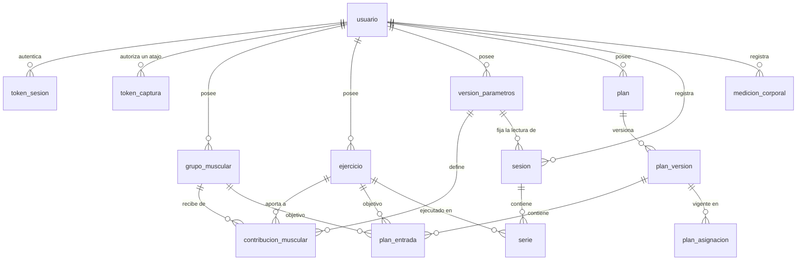

# Modelo de datos

Fuente única de la forma: `src/almacen/esquema.ts`. Fuente única de las reglas:
`src/almacen/invariantes.ts`. Este documento explica el porqué.

## Por qué no «una fila por día»

La idea ingenua —una hoja con una fila por día y una columna por dato— se
descarta por cuatro razones: el número de ejercicios por día es variable y el de
columnas no; impide consultar por serie, que es la granularidad del RIR; el RIR
por serie, la bandera de calentamiento y el pin de parámetros no tienen dónde
vivir; y cada métrica nueva altera la tabla del histórico. El proyecto guarda
sus datos en Excel igualmente, pero **con un modelo relacional**: una hoja por
entidad.

## Archivos y hojas

```
datos/
├── cuentas.xlsx     usuario · token_sesion · token_captura
├── <uuid>.xlsx      un libro por propietario, once hojas
└── respaldos/       copia previa a cada escritura (últimas 20 + primera de cada día)
```

Toda celda es **texto** (formato `@`), también números y fechas. Una celda
numérica, de fecha, booleana o con fórmula es un error de carga con hoja, fila y
columna. Los rangos de vigencia se reparten en `…_desde` (inclusiva) y
`…_hasta` (exclusiva, vacía = abierta).

### Libro de un propietario

| Hoja | Columnas |
| ---- | -------- |
| `grupo_muscular` | id, propietario_id, nombre, creado_en |
| `ejercicio` | id, propietario_id, nombre, archivado_en, creado_en |
| `version_parametros` | id, propietario_id, umbral_rir, vigente_desde, vigente_hasta, creado_en |
| `contribucion_muscular` | id, propietario_id, version_parametros_id, ejercicio_id, grupo_muscular_id, coeficiente |
| `plan` | id, propietario_id, nombre, creado_en |
| `plan_version` | id, propietario_id, plan_id, numero, ciclo_dias, copiada_de, publicada_en, creado_en |
| `plan_entrada` | id, propietario_id, plan_version_id, dia, ejercicio_id, grupo_muscular_id, objetivo |
| `plan_asignacion` | id, propietario_id, plan_version_id, vigente_desde, vigente_hasta, creado_en |
| `sesion` | id, propietario_id, clave_idempotencia, fecha_logica, version_parametros_id, iniciada_en, finalizada_en, fecha_por_confirmar, origen, registrado_en |
| `serie` | id, propietario_id, sesion_id, clave_idempotencia, orden, ejercicio_id, repeticiones, carga_kg, rir, es_calentamiento, realizada_en, registrado_en |
| `medicion_corporal` | id, propietario_id, fecha_logica, peso_kg, origen, registrado_en |

`propietario_id`, `creado_en` y `registrado_en` los pone el almacén, nunca el
cliente ni el servicio. `registrado_en` es el instante de escritura del
servidor: sobre él se apoya la ventana de treinta días del alcance `captura`.

### Cuentas

| Hoja | Columnas |
| ---- | -------- |
| `usuario` | id, correo, hash_contrasena (Argon2id), zona_horaria (IANA), creado_en |
| `token_sesion` | id, usuario_id, huella (HMAC), emitido_en, expira_en, renovado_en |
| `token_captura` | id, usuario_id, huella (HMAC con etiqueta `captura:`), nombre, emitido_en, expira_en, ultimo_uso_en |

## Diagrama



## Invariantes (no negociables)

Se comprueban sobre el conjunto **entero**, con el antes y el después delante,
antes de confirmar cada transacción; al cargar un libro, con antes = después.

| Invariante | Qué garantiza |
| ---------- | ------------- |
| Propiedad | Toda fila lleva el `propietario_id` del libro; una fila ajena impide cargarlo. |
| Unicidad | Identificadores por hoja; nombres de grupo y ejercicio por `trim().toLowerCase()`; `(versión, ejercicio, grupo)` en contribuciones; `(plan, número)`; `(versión, día, destino)` en entradas; claves de idempotencia de sesión y de serie; `(sesión, orden)`; una medición por fecha. |
| Referencias | Toda clave ajena apunta a algo que existe. |
| Calentamiento | `es_calentamiento = true` ⇔ `rir` vacío. |
| Versiones de parámetros | Al menos una; sin solapes; `hasta > desde`. |
| Pin | `sesion.version_parametros_id` no cambia y es **cierto**: la versión regía la fecha lógica de la sesión. |
| Sesión y serie | De una sesión sólo cambian `finalizada_en` y `fecha_por_confirmar`; una serie registrada no se edita (se borra, desde la web). |
| Parámetros congelados | Con una sesión que la fija, la versión no cambia de umbral ni de inicio y el conjunto de sus contribuciones es idéntico: tampoco se le saca ni se le mete una fila reasignando el padre. |
| Versión de plan publicada | Inmutable, igual que el conjunto de sus entradas; nunca vacía. |
| Asignaciones | Sin solapes entre ellas (no hay dos planes vigentes el mismo día); sólo de versiones publicadas. |
| Asignación que cubre sesiones | No se borra, no se re-apunta, no se le mueve el ancla, sólo se cierra por arriba y nunca dejando fuera una sesión que cubría. Asignar hacia atrás sobre sesiones que nadie cubría es legítimo. |
| Rangos de dominio | RIR 0–10; repeticiones 1–200; carga 0–1000 kg; peso 20–400 kg; coeficiente (0, 2]; objetivo (0, 100]; ciclo y día 1–28 (celdas). |
| Exactitud decimal | Todo decimal es cadena con a lo sumo dos posiciones. |

Los rechazos de dominio se deciden en el servicio con una consulta **antes** de
escribir. Si salta un invariante, servidor y almacén no dicen lo mismo: 500.

## El almacén en Excel: cómo se sostiene

| Garantía que daba PostgreSQL | Quién la da ahora |
| ---------------------------- | ----------------- |
| Aislamiento (RLS) | Un archivo por persona; `conAlmacenDeUsuario` no deja nombrar otro. |
| Alcance | `ALCANCE_DE_HOJA`, por afirmación: una hoja sin entrada no la ve nadie. |
| `numeric` | Celdas de texto; el motor parsea a centésimas. |
| Transacciones | Libro entero a un temporal, `sync()`, `rename`. |
| MVCC | Un proceso y una cola de escritura por archivo; orden de bloqueo: cuentas, luego libro. |
| `CHECK`, FK, únicos | `invariantes.ts`. |
| `pg_dump` | Copiar el archivo. |

Porque el archivo **se edita a mano**: no se escribe encima de una edición ajena
(se comparan tamaño, `mtime` e inodo antes de escribir; si cambió, 409 y nada
escrito); se valida al cargar; una columna u hoja desconocida detiene la carga
(ignorarla la borraría en la siguiente escritura). Una columna opcional ausente
es aditiva: un libro viejo simplemente no la trae.

## Versionado de parámetros, con un ejemplo

```
días      1   2   3   4   5   6   7   8   9  10
v1        [===================)                 umbral 4, press→tríceps 0.50
v2                            [=============    umbral 4, press→tríceps 0.75 (editada el día 6)
sesiones  s1      s2      s3      s4      s5
pin       v1      v1      v1      v2      v2
```

Editar el día 6 cierra `v1` en el 7 y crea `v2` desde el 7: lo del día 6 no se
reinterpreta. Si la versión abierta no la fija ninguna sesión, se reescribe en
sitio (ADR-013). La cuenta nace con una versión vigente desde el 2000-01-01, para
que un histórico traído de antes también tenga con qué leerse.

## Los diez defectos que encontró ejecutar el esquema

Se conservan porque siguen siendo invariantes. Los más instructivos: **#4** «el
contenido de una versión es inmutable» estaba escrito en un comentario y no
aplicado; **#7** los guardias miraban sólo al padre nuevo de una fila, y
reasignar el padre vaciaba la versión protegida sin editarle una columna; **#8**
dos objetivos para el mismo destino y día se sumaban; **#9** el pin era inmutable
pero no tenía por qué ser cierto; **#10** la asignación de plan era el último
eslabón reescribible. Lección: una afirmación de la documentación que nada impide
es falsa el día que alguien escriba el cambio.

## Extensión a nutrición

Aditiva: hojas nuevas (`alimento`, `ingesta`, `objetivo_macros`) con su
`propietario_id`, su entrada en `ALCANCE_DE_HOJA` y sus invariantes, cruzadas con
el entrenamiento por `(propietario_id, fecha_logica)`. Si una hoja de
entrenamiento tuviera que cambiar, el diseño estaba mal.
